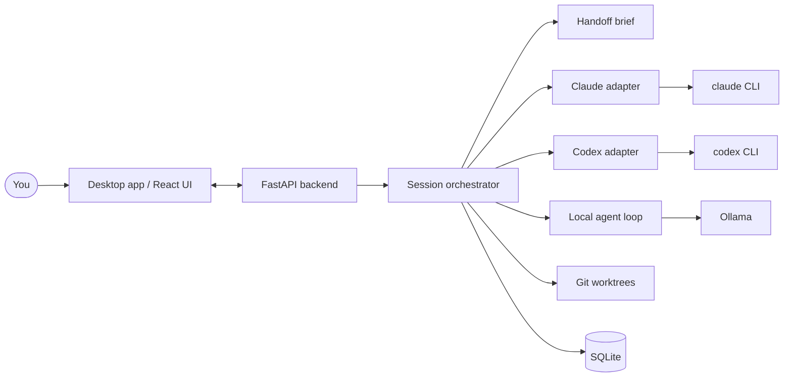

# Multi-Agent Hub

A Windows desktop app for running AI coding agents side by side. Multi-Agent Hub drives **Claude Code** and **OpenAI Codex** through their official CLIs, plus a **local model** through [Ollama](https://ollama.com/). It runs several sessions at once on different projects, and when one agent hits its usage limit it hands the session to the next agent, so work keeps going without repeating the task.

**Bring your own accounts.** The agents run under your own CLI sign-ins and subscriptions (or your own local model). The hub never reads or stores login tokens, needs no API keys, and sends no telemetry.

> **Status: early development (0.x).** The core works day to day, but features are still being added and the data format may change between versions (upgrades migrate your data automatically and keep a backup). There's no installer release yet: build it from source as described below. See the [roadmap](#roadmap).

## Features

- **Agent sessions.** Give Claude Code, Codex or a local model a task in a project folder, watch its messages, tool calls, edits (as diffs) and commands stream in live, and reply when it needs more input. Sessions without a folder are plain **chats**.
- **Parallel sessions.** Run several at once, each showing its agent, model and status (ready, working, handing off, waiting for input, completed, failed).
- **Automatic handoff.** When an agent reports a usage limit, the next agent in the session's chain takes over from a brief the hub builds from saved events and git: the task, your later messages, the previous agent's last messages, files edited, commands run and the diff. Building it costs no agent turns, so it works even when the outgoing agent is out of usage. Turn it off, or have it ask first.
- **Switch agents any time.** Pick another provider, model and reasoning effort from the composer, with the full brief, only your own messages, or a clean start.
- **Local model.** Ollama models with tool support work as a full agent (read, search, edit, run commands, plan, ask you questions) in the hub's own agent loop, with no sign-in and no usage limits.
- **Skills and `/` commands.** A shared skills library (`SKILL.md` folders, from this PC, git or a zip) with a switch per agent, so a skill written for Claude can be used by Codex or the local model. Type `/` for your agents' own skills, the library and hub commands like `/compact`.
- **Git worktrees per session.** In a git repository, each session works in its own worktree on its own `hub/...` branch, so parallel agents never touch each other's files or your checkout.
- **Dashboard, progress and history.** Every session at a glance (the ones waiting on you first), each agent's plan as a checklist, files changed, usage meters per agent, a per-turn history, and summaries the hub writes for free or the agent writes on request.
- **Local-only and locked down.** The backend listens on loopback only and requires a per-install token on every request.

## How it works



The UI talks to a local FastAPI backend. For each session the orchestrator starts the first agent in the chain through its adapter. The Claude and Codex adapters launch the official CLI headless, one process per turn (`claude -p --output-format stream-json`, `codex exec --json`); the local model runs in the hub's own tool loop over Ollama's API. Every adapter turns its output into one shared event stream, saved to SQLite and pushed to the UI live. If a turn ends in a usage limit, the orchestrator builds a handoff brief and starts the next available agent with it.

## Requirements

- Windows 10 or 11, and Git.
- At least one agent, set up with **your own** account:
  - [Claude Code](https://code.claude.com/) (`claude`), signed in with your Claude subscription. The native `claude.exe` is required (not an npm `.cmd` shim).
  - [Codex CLI](https://developers.openai.com/codex/) (`codex`), signed in with your ChatGPT account.
  - [Ollama](https://ollama.com/) with a model that supports tools (for example a Qwen model) for the free local agent.
- To build from source: [uv](https://docs.astral.sh/uv/) (installs the pinned Python for you) and [Node.js](https://nodejs.org/) 22. For the desktop app also [Rust](https://rustup.rs/) (stable, MSVC), the Visual Studio C++ build tools and the WebView2 runtime (included in Windows 11).

## Install

**Installer:** once versions are released, download the `.exe` from [Releases](../../releases) and run it. It installs for your user only (no administrator rights). It isn't code-signed yet, so Windows SmartScreen may warn about an unknown publisher: choose **More info**, then **Run anyway**.

**From source** (PowerShell):

```powershell
git clone https://github.com/SeanEArc/Multi-Agent-Hub.git
cd Multi-Agent-Hub\backend;  uv sync
cd ..\frontend;              npm ci
npm run tauri build          # installer in frontend\src-tauri\target\release\bundle\nsis\
```

Or run it without building the app, as a backend plus the UI in your browser:

```powershell
cd backend;  uv run python -m app.main     # API on http://127.0.0.1:8765
cd frontend; npm run dev                   # second terminal; open http://localhost:5173
```

## Using it

1. Make sure the agents you want are signed in (run `claude` or `codex` once in a terminal), or that Ollama is running.
2. Open the app, choose **New session**, pick a project folder (or none, for a chat), an agent and a model, and type your task.
3. Watch it work; answer when it asks. Use the model picker beside **Send** to switch agents, and **Settings** for the handoff chain, the default model and effort, and the theme.

Your data stays on your PC in `%LOCALAPPDATA%\MultiAgentHub`: the database (`data\hub.db`, with pre-upgrade copies in `data\backups`), session worktrees, chats, the local model's conversations, the skills library and logs.

## Configuration

Most settings are in the app's **Settings** dialog. Advanced ones are `HUB_*` environment variables or entries in `backend/.env` (see [`backend/.env.example`](backend/.env.example)); all are optional.

| Setting | Default | Purpose |
|---|---|---|
| `HUB_HOST` / `HUB_PORT` | `127.0.0.1` / `8765` | API address. The host must be loopback; the app refuses to start otherwise. |
| `HUB_DATABASE_URL` | `%LOCALAPPDATA%\MultiAgentHub\data\hub.db` | SQLite database location. |
| `HUB_WORKTREES_DIR`, `HUB_CHATS_DIR`, `HUB_LOCAL_DIR`, `HUB_SKILLS_DIR` | under `%LOCALAPPDATA%\MultiAgentHub` | Where worktrees, chat folders, local-model conversations and the skills library live. Keep worktrees outside any repository. |
| `HUB_CLAUDE_PERMISSION_MODE` | `acceptEdits` | Claude Code's permission mode. With `acceptEdits` Claude can edit files but shell commands are denied, because a headless session can't ask for approval; `auto` lets Claude Code's safety check approve safe commands. Neither is a sandbox. |
| `HUB_CODEX_SANDBOX` | `workspace-write` | Codex's sandbox mode. |
| `HUB_CODEX_PATH` | auto-detected | Path to the native `codex.exe`. |
| `HUB_OLLAMA_URL` | `http://127.0.0.1:11434` | Ollama server (loopback only). |
| `HUB_OLLAMA_MODEL`, `HUB_OLLAMA_NUM_CTX`, `HUB_OLLAMA_MAX_ROUNDS`, `HUB_OLLAMA_COMMAND_TIMEOUT` | auto, `32768`, `30`, `300` | Local model, context size, tool rounds per turn and command timeout (seconds). |
| `HUB_LOG_LEVEL` | `info` | Log level. |

Developer settings (`HUB_RELOAD`, `HUB_SIMULATE_LIMIT`, token and lock files) are described in [`CLAUDE.md`](CLAUDE.md).

## Security and privacy

Agents launched by the hub can edit files and run commands, so:

- The backend listens on loopback only. Every `/api` request needs a bearer token, generated per install (readable only by your Windows account) or per launch in the desktop app. Requests with a foreign `Host`, an unknown `Origin` or `Sec-Fetch-Site: cross-site` are rejected.
- The hub never reads, stores or logs your Claude or Codex login tokens. It talks to Anthropic and OpenAI only through their own CLIs, and to nothing else on the internet except what you ask for (git clones of skills).
- Git worktrees keep sessions apart, but they are **not a sandbox**: an agent can read other files on your PC. Codex's sandbox limits its writes; Claude Code is limited by its permission mode. Container isolation is on the roadmap.

To report a vulnerability, see [`SECURITY.md`](SECURITY.md).

## Roadmap

Next: Claude's and Codex's own commands in the hub (`/compact`, `/context`, `/usage`, `/code-review`) and attachments, image generation, and **delegation** (one agent hands a sub-task to another and gets a report back). Later: parallel split of one task across agents, Docker isolation, design styles, auto-update and access from a phone. The full plan is in [`docs/plan.md`](docs/plan.md).

## Contributing

Contributions are welcome. See [`CONTRIBUTING.md`](CONTRIBUTING.md) for setup, tests and how pull requests flow (`staging` first, then `main`), and [`RELEASING.md`](RELEASING.md) for how versions are released. The architecture is documented in [`CLAUDE.md`](CLAUDE.md), and the development log is in [`docs/progress.md`](docs/progress.md).

## Project layout

```
backend/             FastAPI backend (Python, uv)
  app/adapters/      Claude, Codex and local-model adapters, process runner
  app/api/           HTTP routes under /api
  app/migrations/    Alembic database migrations
  tests/             Pytest suite with fake Claude, Codex and Ollama
frontend/            React + TypeScript UI (Vite)
  src-tauri/         Tauri desktop shell (Rust)
docs/                Plan, development log, manual test checklist, notes
scripts/version.py   Keeps the version the same in every file
```

## License

MIT. See [`LICENSE`](LICENSE).

Multi-Agent Hub is an independent project, not affiliated with or endorsed by Anthropic, OpenAI or Ollama. Claude, Claude Code, Codex and Ollama are trademarks of their owners.
