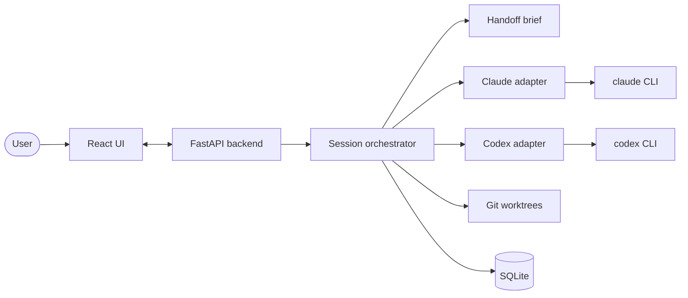

# Multi-Agent Hub

A personal Windows desktop hub for running AI coding agents side by side. Multi-Agent Hub drives **Claude Code** and **OpenAI Codex** through their official CLIs, runs several sessions at once on different projects, and hands a session to the next agent automatically when one hits its usage limit, so work keeps going without repeating the task.

The agents run under your own CLI logins and subscriptions. The hub never reads or stores login tokens, and no API keys are needed.

## Features

- **Agent sessions.** Start a task in any project folder with Claude Code or Codex, watch its messages, tool calls and commands stream in live, and reply when it needs more input.
- **Parallel sessions.** Run several sessions at once, each showing its current agent, model and status (ready, working, handing off, waiting for input, completed, failed).
- **Automatic handoff.** When an agent reports a usage limit, the next agent in the session's chain takes over from a hub-built brief: the task, your later messages, the previous agent's last messages, files edited, commands run and the git diff. The hub builds the brief from saved events, so it costs no agent turns and works even when the outgoing agent is out of usage.
- **Manual handoff.** Move a session to another agent at any time with the hand-off button, optionally with a note.
- **Configurable chains.** A global default chain and limit policy (hand off automatically, or ask first), with a per-session override.
- **Questions from agents.** When an agent needs your answer, the session moves to *waiting for input* until you reply.
- **Usage meters.** Each agent's plan usage windows, plus cost (Claude) or token counts (Codex) per turn.
- **Git worktrees per session.** Sessions in a git repository work in their own worktree on their own `hub/...` branch, so parallel agents never touch each other's files or your checkout. Removing a worktree keeps the branch for you to merge.
- **History.** Every event, handoff and brief is stored in SQLite, with a divider in the transcript at each handoff.
- **Local-only API.** The backend binds to loopback only and requires a per-install bearer token on every route.

## How it works



The React UI talks to a local FastAPI backend. For each session the orchestrator creates a git worktree (when the folder is a repository) and starts the first agent in the chain through its adapter. Each adapter launches the official CLI headless, one process per turn (`claude -p --output-format stream-json`, `codex exec --json`), and normalizes its output into a shared event stream that is saved to SQLite and pushed to the UI over server-sent events. If a turn ends in a usage limit, the orchestrator builds a handoff brief and starts the next available agent with it.

## Requirements

- Windows 10 or 11
- [uv](https://docs.astral.sh/uv/) (installs the pinned Python 3.14 for you)
- [Node.js](https://nodejs.org/) with npm
- Git
- At least one agent CLI, installed and signed in:
  - [Claude Code](https://code.claude.com/) (`claude`), signed in with your Claude subscription. The native `claude.exe` is required.
  - [Codex CLI](https://developers.openai.com/codex/) (`codex`), signed in with your ChatGPT account.

## Getting started

All commands are for PowerShell.

1. **Install and start the backend:**

   ```powershell
   cd backend
   uv sync
   uv run python -m app.main
   ```

   The API runs at http://127.0.0.1:8765 (interactive docs at `/docs`). On first start it creates the database (`backend/data/hub.db`) and the API token (`backend/data/token`), and it applies database migrations on every start.

2. **In a second terminal, start the UI:**

   ```powershell
   cd frontend
   npm install
   npm run dev
   ```

3. **Open http://localhost:5173**, choose **New session**, pick a project folder and an agent, and enter a task.

The Vite dev server forwards `/api` to the backend and adds the API token to each request, so the browser never holds it.

## Configuration

Settings are `HUB_*` environment variables or entries in `backend/.env` (see [`backend/.env.example`](backend/.env.example)). Shell variables take precedence. All are optional.

| Setting | Default | Purpose |
|---|---|---|
| `HUB_HOST` | `127.0.0.1` | Bind address. Must be loopback; the app refuses to start otherwise. |
| `HUB_PORT` | `8765` | API port. |
| `HUB_DATABASE_URL` | `backend/data/hub.db` | SQLite database location. |
| `HUB_TOKEN_FILE` | `backend/data/token` | API token file. Set it for both the backend and the Vite dev server. |
| `HUB_WORKTREES_DIR` | `%LOCALAPPDATA%\MultiAgentHub\worktrees` | Where session worktrees are created. Keep it outside any repository. |
| `HUB_CORS_ORIGINS` | Vite dev server origins | JSON array of allowed browser origins. |
| `HUB_CLAUDE_PERMISSION_MODE` | `acceptEdits` | Permission mode passed to Claude Code. |
| `HUB_CODEX_SANDBOX` | `workspace-write` | Sandbox mode passed to Codex. |
| `HUB_CODEX_PATH` | auto-detected | Path to the native `codex.exe`. |
| `HUB_RELOAD` | `false` | Restart the backend on code changes (development). |
| `HUB_LOG_LEVEL` | `info` | Log level. |
| `HUB_SIMULATE_LIMIT` | unset | Development only: comma-separated agents (`claude`, `codex`) whose turns end in a simulated usage limit, to try handoff. Real usage is still spent. |

The handoff chain and limit policy are set in the app's **Settings** dialog and stored in the database.

## Security

Agents launched by the hub can edit files and run commands, so the API is locked down to your own machine:

- The backend binds to a loopback address only.
- Every `/api` route, including the event stream, requires `Authorization: Bearer <token>`, checked in constant time. The token is generated on first start and its file is readable only by your Windows account. Delete it and restart to rotate it.
- Requests with a non-loopback `Host`, an unknown `Origin`, or `Sec-Fetch-Site: cross-site` are rejected.
- The hub never reads, stores or logs CLI login tokens or the API token.

Git worktrees isolate sessions from each other, but they are **not a security sandbox**: an agent can still read other files on your PC. Codex's own sandbox limits writes; Claude Code is limited by its permission settings.

To call the API by hand:

```powershell
$token = Get-Content backend\data\token
Invoke-RestMethod http://127.0.0.1:8765/api/sessions -Headers @{ Authorization = "Bearer $token" }
```

## Development

### Tests

```powershell
cd backend
uv run pytest                                    # all tests (fake CLIs, no usage spent)
uv run pytest tests/test_claude_adapter.py::test_name   # a single test
```

Live tests run against the real CLIs and spend real subscription usage, so they are opt-in:

```powershell
$env:HUB_LIVE_CLAUDE="1"; uv run pytest tests/test_claude_live.py
$env:HUB_LIVE_CODEX="1";  uv run pytest tests/test_codex_live.py
```

### Frontend checks

```powershell
cd frontend
npm run typecheck
npm run build
```

### Database schema changes

Edit `backend/app/models.py`, then generate a migration and review it before committing:

```powershell
uv run alembic revision --autogenerate -m "describe the change"
```

The app applies pending migrations on the next start.

### Dependencies

Backend dependencies are managed with uv (`uv add <pkg>`, `uv add --dev <pkg>`), and `uv.lock` is committed. Frontend dependencies use npm, with `package-lock.json` committed.

## Project layout

```
backend/
  app/
    main.py           App factory, middleware, routers
    config.py         HUB_* settings
    auth.py           API token, bearer check, Host/Origin checks
    db.py, models.py  SQLite engine, tables, migrations at startup
    orchestrator.py   Runs turns, saves events, handles limits and handoff
    handoff.py        Builds the handoff brief from events and git
    worktrees.py      Per-session git worktrees
    adapters/         Agent interface, Claude and Codex adapters, process runner
    api/              HTTP routes under /api
    migrations/       Alembic migrations
  tests/              Pytest suite with fake Claude and Codex CLIs
frontend/
  src/                React + TypeScript UI (Vite)
plan.md               Requirements, design decisions and build phases
progress.md           Per-session development log
```

See [`backend/README.md`](backend/README.md) and [`frontend/README.md`](frontend/README.md) for more detail on each part.
