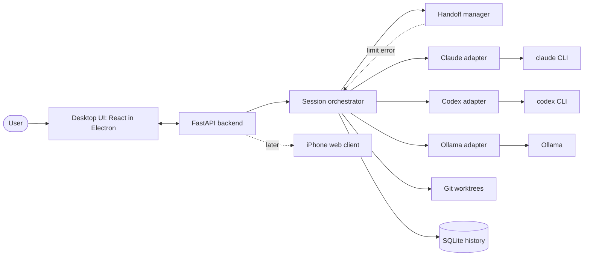

# Plan: Multi-Agent Hub

Working name: `multi-agent-hub`. Status: confirmed by the user in the planning interview. Platform: Windows desktop, personal use only.

## 1. Purpose and requirements

**Problem.** Using Claude Code, ChatGPT/Codex and local models means switching between separate apps, with no shared view of what each agent is doing, and work stops when a subscription runs out of usage.

**Intended user.** The author only (individual use). No accounts, multi-tenancy or hosting.

**Long-term goal.** A centralized place to call upon different AI agents, run several at once on different projects, review their progress and reports, and eventually do the same from an iPhone ("code on the go").

**Platform.** Windows desktop application, hosted on the user's PC. A mobile (iPhone) client is a later phase, not part of the first build.

**Core features**
- Agents: Claude Code, Codex (ChatGPT subscription) and a local model via Ollama.
- Subscription use: Claude and Codex are driven through their official CLIs running under the user's own logins. The application never reads or stores login tokens. API keys are used only where free.
- Parallel sessions on different projects, each showing the active agent and model.
- Session status flow: ready to accept prompt → working → handing off → waiting for input → task completed.
- Progress view per session. The way subagent progress is displayed is undecided and will be settled during the build.
- Clicking a session shows its history and a per-task summary.
- Automatic handoff when an agent hits a limit error (default chain Claude → Codex → local model). The chain is configurable per session, with a default config when the user sets nothing.
- A "waiting for user input" state, so skills that ask the user questions can run.
- UI style: a blend of the Claude Code and Codex interfaces.

**Basis and inspiration.** Not based on an existing product. UI inspiration: Claude Code and Codex.

## 2. Scope and exclusions

**In scope**
- Everything under core features above.
- Git worktrees to isolate parallel agents working on the same repository.
- A UI-independent backend API so a mobile client can be added later.

**Exclusions**
- Gmail and other non-coding agent tasks (deferred by the user; the adapter design should not prevent them later).
- The iPhone app and remote access (postponed to a later phase).
- Multi-user features.
- RAG, evaluations and ML features (the user's future project; the Python backend is chosen so they can be added later).
- Docker isolation (deferred; see tradeoffs).
- Running or installing agents on the phone.

No out-of-scope item was kept against a challenge. All deferrals are the user's decisions.

## 3. Tech stack and rationale

| Layer | Choice | Label |
|---|---|---|
| Backend | Python + FastAPI: agent sessions, scheduling, handoff, task management | User choice |
| Desktop shell | Electron, with the Python backend bundled as a sidecar process; Tauri is the alternative | Default assumption, to be revisited in phase 1 |
| UI | React + TypeScript | User-supplied table, accepted |
| Agent adapters | One interface per agent: start task, send reply, stream events, report limit error, stop | User choice |
| Claude control | Approach A: run the official `claude` CLI headless as a child process and read its streamed events | User choice |
| Local models | Ollama, behind an adapter | User-supplied table, accepted |
| Storage | SQLite: tasks, settings, logs, history | User-supplied table, accepted |
| Isolation | Git worktrees per session or agent | User-supplied table, accepted |

**Rationale.** Python is the user's strongest language and keeps a clean path to RAG, evaluations and ML. React keeps the UI reusable as a future iPhone web client, and the FastAPI backend already provides the API for it. The adapter interface lets the way an agent is driven be swapped without touching handoff, the UI or history.

**Alternatives considered**
- Node/TypeScript backend: simpler packaging and one language with the UI; rejected because the user is stronger in Python.
- Claude via pseudo-terminal with Claude Code hooks (approach B): lowest policy risk and handles interactive input naturally, but harder to parse and to hand off automatically; kept as a possible adapter swap.
- Claude via Agent SDK or API key (approach C): supported by policy but billed per token; kept as a manual fallback.
- PySide6 desktop UI: one language, but the UI would not carry over to mobile.
- Tauri instead of Electron: smaller and lighter, but needs a sidecar for Python just as Electron does.
- Separate Node orchestrator plus Python AI service: more machinery than needed for the first version.

## 4. Tradeoffs

- **Subscription use via official CLIs.** Positive: uses existing subscriptions, with no token handling by the app. Negative: Anthropic's policy on subscription use outside Claude Code and Claude.ai has been contested and changed several times in 2026; secondary sources report server-side blocking of third-party clients and a later reported allowance for CLI-style individual use. **General knowledge, unverified against Anthropic's own current pages** (secondary sources: Gigazine, The New Stack, WinBuzzer). The user accepted this risk for individual use. Fallback: API key per session.
- **Codex via ChatGPT sign-in.** Positive: Codex is included in ChatGPT plans, and `codex exec --json` gives machine-readable events with token usage and failures; `codex exec resume` continues a session. **Verified** against OpenAI help and developer docs (help.openai.com Codex usage limits; developers.openai.com/codex/noninteractive), though the exact JSON event schema was read from mirrored docs and must be rechecked. Negative: a third-party report says Windows sign-in may still produce API charges; **unverified**.
- **Python backend plus Electron shell.** Positive: strongest language for the author, and a path to AI features. Negative: two languages (TypeScript UI, Python backend), a bundled Python runtime, and the shell must start, monitor and restart the backend. **General knowledge, unverified.**
- **Electron versus Tauri.** One 2026 test reports about 3 MB versus 85 MB bundles and about 42 MB versus 168 MB idle memory in favor of Tauri; sources vary and no measurement of a Python sidecar was found. **Source-reported, partly unverified** (DevToolPicks). Electron's advantage is tooling familiarity.
- **React UI and FastAPI API.** Positive: the same UI can become the iPhone web app later. Negative: the network layer and login add work then. **General knowledge, unverified.**
- **Git worktrees without Docker.** Positive: lightweight, and agents on the same repository do not overwrite each other. Negative: not a security sandbox; agents can still reach the user's files. Docker would add Docker Desktop weight on Windows and complicate use of logged-in CLIs. **General knowledge, unverified.**
- **Limit detection.** "Nearing the limit" may only be detectable after a limit error appears; early warning is best effort. **Unverified.**
- **Vendor handoff.** Sessions cannot share native state across vendors, so context is rebuilt from a written summary plus the git diff. Some detail is lost, and local models are much weaker at coding. **General knowledge, unverified.**
- **iPhone delivery (later).** Installable web app: free, no re-signing, push notifications reportedly need a home-screen install. Free Apple ID sideload: expires every 7 days, 3-app limit, reportedly no push. Paid developer account (about $99/year) removes the limits. **Secondary sources, mostly unverified** (superappp.com, mjtsai.com).
- **Remote access (later).** Tailscale is the easiest private option with a free personal tier (limits differ across sources); self-hosted WireGuard needs managed keys and a reachable port; Cloudflare Tunnel is public by design and would need its own login. Source: homelabstarter.substack.com; **unverified**, check current pricing.
- **Interactive input.** Whether headless `claude -p` and `codex exec` support replies mid-run is **unverified**; the fallback is the pseudo-terminal approach for such sessions.
- **Claude Code hooks.** Official hooks docs list `Stop` and `SubagentStop` events (docs.anthropic.com hooks page); field details are from secondary sources. The `claude -p` streaming-JSON flags were **not verified**.

## 5. How the application works

The user opens the desktop app and creates a session for a project, optionally choosing the agent chain. The React interface talks to a local FastAPI backend. For each session the orchestrator creates a git worktree and starts the first agent through its adapter, which launches the official CLI or Ollama and streams events back. The UI shows the agent and model in use, the session status and progress. If an adapter reports a limit error, the handoff manager writes a summary of the task, what is done and what remains, plus the git diff, and the orchestrator starts the next agent in the chain with that summary. When an agent asks a question, the session moves to waiting for input until the user replies. When the work finishes, the session shows task completed. All events and summaries are stored in SQLite, so clicking a session shows its history and per-task summary. The same API is intended to serve a mobile client later.

## 6. Build phases

**Phase 1: Core and Claude**
- Goal: one Claude session working end to end.
- In scope: FastAPI core, adapter interface, Claude adapter (approach A), SQLite history, basic UI shell, verification of the streaming-event and interactive-input behavior of `claude -p`, and the final Electron-versus-Tauri decision.
- Exclusions: Codex, handoff, multi-session dashboard.
- Dependencies: Claude Code CLI installed and logged in.
- Acceptance: the user starts a session, sees status and events, replies to a question, and sees the completed session in history.
- Tradeoffs: including the verification here avoids building on unconfirmed behavior; deferring it risks rework in every later phase.

**Phase 2: Codex adapter**
- Goal: the same session experience with Codex.
- In scope: Codex adapter using `codex exec --json` and resume, event mapping to the shared interface, a check of the Windows sign-in billing report.
- Exclusions: handoff.
- Dependencies: phase 1, Codex CLI logged in with the ChatGPT account.
- Acceptance: a Codex session runs and appears in the UI like a Claude session, with no API charges.
- Tradeoffs: doing this before handoff proves the adapter interface works for two different agents.

**Phase 3: Automatic handoff**
- Goal: work continues on the next agent when a limit error occurs.
- In scope: limit-error detection per adapter, handoff summary generation (task, done, remaining, git diff), configurable chain per session with a default config, UI indication of handoff.
- Exclusions: local model in the chain until phase 5.
- Dependencies: phases 1 and 2.
- Acceptance: a simulated or real limit error moves a session from Claude to Codex and the task continues from the summary.
- Tradeoffs: early-warning detection is best effort; the context lost in a summary may require the user to correct course.

**Phase 4: Multi-session dashboard and isolation**
- Goal: several sessions on different projects, reviewable in one place.
- In scope: dashboard, progress view (style decided here), per-session history and summaries, git worktrees per session, Claude Code and Codex style polish.
- Exclusions: remote access.
- Dependencies: phases 1 to 3.
- Acceptance: two or more sessions run in parallel without file conflicts, and each session's history and summary are viewable.
- Tradeoffs: worktrees are not a sandbox; the subagent display decision may need a design iteration.

**Phase 5: Local model**
- Goal: Ollama as the last-resort tier.
- In scope: Ollama adapter, local model selection, addition to the default handoff chain.
- Exclusions: RAG, evaluations.
- Dependencies: phases 1 to 3, Ollama installed with a chosen model.
- Acceptance: a handoff from Codex to a local model completes a simple task, with the quality limits clearly shown.
- Tradeoffs: local models are weaker at coding, and hardware determines usefulness; the model choice is open.

**Phase 6 (later): iPhone access**
- Goal: monitor and control sessions from the phone.
- In scope: network exposure of the API, login, mobile web client, private remote access.
- Exclusions: running agents on the phone.
- Dependencies: phases 1 to 4.
- Acceptance: from the phone, the user can see session status and send replies.
- Tradeoffs: see iPhone delivery and remote access above.

## 7. Decisions, assumptions, and open questions

**Confirmed decisions**
- Desktop application, personal use, Windows.
- Python + FastAPI backend.
- Approach A for Claude with a swappable adapter interface.
- Automatic handoff on limit error, configurable per session with a default config.
- Mobile postponed; Gmail and non-coding agents deferred.
- Phase order as in section 6.
- UI blends Claude Code and Codex.
- Stack items from the user-supplied table are accepted except the Node orchestrator and the separate Python AI service (merged into the FastAPI backend) and Docker (deferred).

**Assumptions**
- Electron is the default desktop shell; revisit in phase 1. Effect: if Tauri is chosen, the shell is smaller but needs Rust knowledge.
- Windows only.
- The CLIs and Ollama are installed and logged in by the user separately.
- SQLite is local to the PC.
- Default handoff chain is Claude → Codex → local model.

**Unresolved**
- Subagent progress display style (decide during phase 4).
- Local model runtime model and hardware (Ollama chosen; specific model open).
- Whether headless `claude -p` and `codex exec` support mid-run user input (check in phase 1).
- Current Anthropic policy on subscription CLI use (recheck against Anthropic's own pages).
- Windows Codex sign-in billing report.
- Whether limit nearing can be detected before the error.
