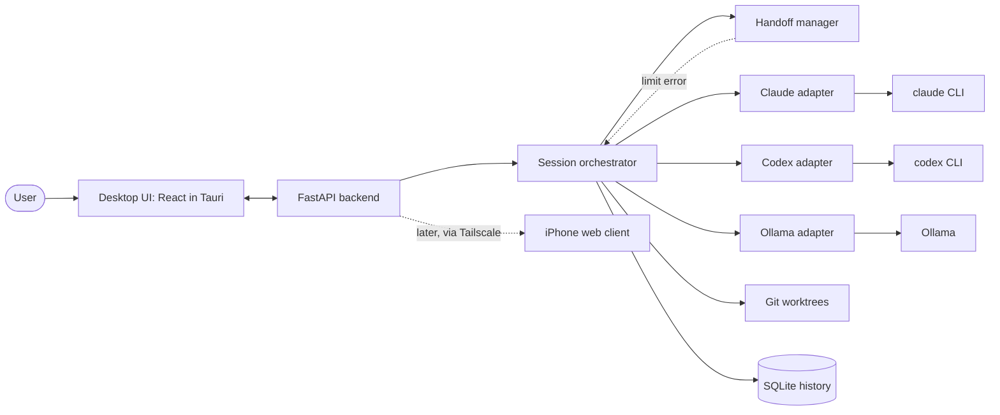

# Plan: Multi-Agent Hub

Working name: `multi-agent-hub`. Status: confirmed by the user in the planning interview. Platform: Windows desktop, personal use only.

## Roadmap

Phases are listed in build order. The numbers are stable labels, not the order: phases 7 to 10 were added after phase 6, and numbers are kept so existing references stay valid.

| Order | Phase | Status |
|---|---|---|
| 1 | 1 to 3: Claude, Codex, handoff | Done |
| 2 | 4a to 4c: worktrees, dashboard, style polish | Done |
| 3 | 4d: Tauri shell | Done |
| 4 | 5a to 5d: Local model (hub's own agent loop, Ollama first) | 5a to 5c done (merged and checked in the app 2026-11-10); 5d on hold |
| 5 | APPLICATION REVISION: Session flow (new session opens a chat, pickers under the composer, chaining switches) | Not started, scope drafted 2026-11-10 |
| 6 | 7: Delegation | Not started, open questions settled |
| 7 | 8: Parallel split | Not started |
| 8 | 9: Docker isolation | Not started |
| 9 | 10: Design styles and layouts | Not started |
| 10 | 6: iPhone access, including Tailscale | Not started |

## 1. Purpose and requirements

**Problem.** Using Claude Code, ChatGPT/Codex and local models means switching between separate apps, with no shared view of what each agent is doing, and work stops when a subscription runs out of usage.

**Intended user.** The author only (individual use). No accounts, multi-tenancy or hosting.

**Long-term goal.** A centralized place to call upon different AI agents, run several at once on different projects, review their progress and reports, and eventually do the same from an iPhone ("code on the go").

**Platform.** Windows desktop application, hosted on the user's PC. A mobile (iPhone) client is a later phase, not part of the first build.

**Core features**
- Agents: Claude Code, Codex (ChatGPT subscription) and a local model via Ollama.
- Subscription use: Claude and Codex are driven through their official CLIs running under the user's own logins. The application never reads or stores login tokens. API keys are used only where free.
- Parallel sessions on different projects, each showing the active agent and model.
- Session status flow: ready to accept prompt → working → handing off → waiting for input → task completed.
- Progress view per session. The way subagent progress is displayed is undecided and will be settled during the build.
- Clicking a session shows its history and a per-task summary.
- Automatic handoff when an agent hits a limit error (default chain Claude → Codex → local model). The chain is configurable per session, with a default config when the user sets nothing.
- Manual handoff: the user can move a session to another agent at any time with a hand-off button (added 2026-10-25).
- Delegation (later phase, added 2026-10-25): the user hands a sub-task to another agent, which works on it and then returns to the original agent with a short report of what it did and changed, like an orchestrator.
- Parallel split (later phase, added 2026-10-25): several agents work on parts of one task at the same time and their work is combined. It starts with a simple user-triggered split and is developed further later. Several sessions at once on different projects is a separate requirement, covered by phase 4.
- A "waiting for user input" state, so skills that ask the user questions can run.
- UI style: a blend of the Claude Code and Codex interfaces.

**Basis and inspiration.** Not based on an existing product. UI inspiration: Claude Code and Codex.

## 2. Scope and exclusions

**In scope**
- Everything under core features above.
- Git worktrees to isolate parallel agents working on the same repository.
- A UI-independent backend API so a mobile client can be added later.

**Exclusions**
- Gmail and other non-coding agent tasks (deferred by the user; the adapter design should not prevent them later).
- The iPhone app and remote access (postponed to a later phase).
- Multi-user features.
- RAG, evaluations and ML features (the user's future project; the Python backend is chosen so they can be added later).
- Docker isolation in the first build. It is planned as phase 9 (decided 2026-10-25), after phase 4 and before phase 6; see tradeoffs.
- Running or installing agents on the phone.

No out-of-scope item was kept against a challenge. All deferrals are the user's decisions.

## 3. Tech stack and rationale

| Layer | Choice | Label |
|---|---|---|
| Backend | Python + FastAPI: agent sessions, scheduling, handoff, task management | User choice |
| Desktop shell | Tauri, with the Python backend bundled as a sidecar process | User choice (decided 2026-10-22, replacing the Electron default) |
| Remote access (phase 6) | Tailscale, with `tailscale serve` for HTTPS | User choice (decided 2026-10-22) |
| UI | React + TypeScript | User-supplied table, accepted |
| Agent adapters | One interface per agent: start task, send reply, stream events, report limit error, stop | User choice |
| Claude control | Approach A: run the official `claude` CLI headless as a child process and read its streamed events | User choice |
| Local models | Any local model the user installs, behind an adapter, with no subscription needed; engine (Codex CLI with `--oss` or the hub's own agent loop) and runtimes (Ollama, LM Studio, OpenAI-compatible) open, see phase 5 | User-supplied table (Ollama); revised 2026-11-09 |
| Storage | SQLite: tasks, settings, logs, history | User-supplied table, accepted |
| Isolation | Git worktrees per session or agent (phase 4); Docker containers per session (phase 9) | User-supplied table, accepted; containers added 2026-10-25 |

**Rationale.** Python is the user's strongest language and keeps a clean path to RAG, evaluations and ML. React keeps the UI reusable as a future iPhone web client, and the FastAPI backend already provides the API for it. The adapter interface lets the way an agent is driven be swapped without touching handoff, the UI or history.

**Alternatives considered**
- Node/TypeScript backend: simpler packaging and one language with the UI; rejected because the user is stronger in Python.
- Claude via pseudo-terminal with Claude Code hooks (approach B): lowest policy risk and handles interactive input naturally, but harder to parse and to hand off automatically; kept as a possible adapter swap.
- Claude via Agent SDK or API key (approach C): supported by policy but billed per token; kept as a manual fallback.
- PySide6 desktop UI: one language, but the UI would not carry over to mobile.
- Electron instead of Tauri: more familiar tooling and no Rust, but much larger bundles and idle memory, and it still needs a Python sidecar.
- Self-hosted WireGuard or Cloudflare Tunnel instead of Tailscale: WireGuard needs managed keys and a reachable port; Cloudflare Tunnel is public by design and would need its own login in front of the app.
- Separate Node orchestrator plus Python AI service: more machinery than needed for the first version.

## 4. Tradeoffs

- **Subscription use via official CLIs.** Positive: uses existing subscriptions, with no token handling by the app. Negative: Anthropic's policy on subscription use outside Claude Code and Claude.ai has been contested and changed several times in 2026; secondary sources report server-side blocking of third-party clients and a later reported allowance for CLI-style individual use. **General knowledge, unverified against Anthropic's own current pages** (secondary sources: Gigazine, The New Stack, WinBuzzer). The user accepted this risk for individual use. Fallback: API key per session.
- **Codex via ChatGPT sign-in.** Positive: Codex is included in ChatGPT plans, and `codex exec --json` gives machine-readable events with token usage and failures; `codex exec resume` continues a session. **Verified** against OpenAI help and developer docs (help.openai.com Codex usage limits; developers.openai.com/codex/noninteractive), and the JSON event schema was checked live against codex-cli 0.164.0 on 2026-10-25 (it reports no usage-window status, unlike Claude). Negative: a third-party report says Windows sign-in may still produce API charges; **unverified**.
- **Python backend plus Tauri shell.** Positive: strongest language for the author, and a path to AI features. Negative: three languages (TypeScript UI, Python backend, a small amount of Rust in the shell), a bundled Python runtime (for example a PyInstaller build registered as a Tauri sidecar binary), and the shell must start, monitor and restart the backend. **General knowledge, unverified.**
- **Tauri versus Electron (decided: Tauri).** One 2026 test reports about 3 MB versus 85 MB bundles and about 42 MB versus 168 MB idle memory in favor of Tauri; sources vary and no measurement of a Python sidecar was found, which will dominate the bundle size either way. **Source-reported, partly unverified** (DevToolPicks). Cost accepted: the shell's main process is Rust instead of Node, and the Rust toolchain plus the WebView2 runtime are needed to build. The Tauri webview has its own origin (on Windows reportedly `http://tauri.localhost`), which the backend's `Origin` check must allow; **unverified, check against the Tauri version used**.
- **React UI and FastAPI API.** Positive: the same UI can become the iPhone web app later. Negative: the network layer and login add work then. **General knowledge, unverified.**
- **Git worktrees first, Docker later (decided 2026-10-25: Docker as phase 9).** Worktrees are lightweight, and agents on the same repository do not overwrite each other, but they are not a security sandbox: until phase 9 an agent can still read the user's files (Codex's own sandbox limits writes, not reads; Claude has only permission rules). Docker gives real isolation but costs Docker Desktop on Windows, a separate CLI login inside the container (the Windows logins can't be shared in), a toolchain image per project, and slow file access for projects on the Windows drive mounted into WSL2-based Linux containers. The usual fix for that is keeping projects inside the WSL file system. It is planned before phase 6 because remote control from the phone raises the stakes more than parallel sessions do. **General knowledge, unverified** (in particular the mount speed on this PC and whether Codex's ChatGPT sign-in works inside a container).
- **Limit detection.** "Nearing the limit" may only be detectable after a limit error appears; early warning is best effort. **Unverified.**
- **Vendor handoff.** Sessions cannot share native state across vendors, so context is rebuilt from a written summary plus the git diff. Some detail is lost, and local models are much weaker at coding. **General knowledge, unverified.**
- **iPhone delivery (later).** Installable web app: free, no re-signing, push notifications reportedly need a home-screen install. Free Apple ID sideload: expires every 7 days, 3-app limit, reportedly no push. Paid developer account (about $99/year) removes the limits. **Secondary sources, mostly unverified** (superappp.com, mjtsai.com).
- **Remote access (later, decided: Tailscale).** Tailscale is the easiest private option with a free personal tier (limits differ across sources); self-hosted WireGuard needs managed keys and a reachable port; Cloudflare Tunnel is public by design and would need its own login. Source: homelabstarter.substack.com; **unverified**, check current pricing. Cost accepted: a dependency on a third-party coordination service and the Tailscale app on both the PC and the iPhone. The API is reachable only from devices on the user's tailnet, but the app's own login is still required (phase 6), so a lost or shared tailnet device does not grant control of agents.
- **Interactive input.** Whether headless `claude -p` and `codex exec` support replies mid-run is **unverified**; the fallback is the pseudo-terminal approach for such sessions.
- **Claude Code hooks.** Official hooks docs list `Stop` and `SubagentStop` events (docs.anthropic.com hooks page); field details are from secondary sources. The `claude -p` streaming-JSON flags were **not verified**.

## 5. How the application works

The user opens the desktop app and creates a session for a project, optionally choosing the agent chain. The React interface talks to a local FastAPI backend. For each session the orchestrator creates a git worktree and starts the first agent through its adapter, which launches the official CLI or Ollama and streams events back. The UI shows the agent and model in use, the session status and progress. If an adapter reports a limit error, the handoff manager writes a summary of the task, what is done and what remains, plus the git diff, and the orchestrator starts the next agent in the chain with that summary. When an agent asks a question, the session moves to waiting for input until the user replies. When the work finishes, the session shows task completed. All events and summaries are stored in SQLite, so clicking a session shows its history and per-task summary. The same API is intended to serve a mobile client later.

## 6. Build phases

**Phase 1: Core and Claude** (done 2026-10-24)
- Status: complete. The acceptance test passed in the browser (2026-10-20), and minimal local authentication is in place: per-install token file, bearer check on every route and the stream, `Host`/`Origin` checks, loopback-only binding, token added by the Vite dev proxy. Passing the token from the Tauri main process to the sidecar is part of phase 4d.
- Goal: one Claude session working end to end.
- In scope: FastAPI core, adapter interface, Claude adapter (approach A), SQLite history, basic UI shell, verification of the streaming-event and interactive-input behavior of `claude -p`, the desktop-shell decision (decided 2026-10-22: Tauri), and minimal local authentication (see below).
- Desktop shell: building the Tauri shell and packaging the backend as its sidecar is deferred to phase 4d; until then the UI runs in a browser against the local API, and the Vite dev proxy reads the token file and adds the `Authorization` header to `/api` requests in place of the shell.
- Minimal local authentication: a random per-install token generated on first run and stored locally with user-only access; one FastAPI dependency requiring `Authorization: Bearer <token>` on every REST route and on the event stream (constant-time comparison, 401 otherwise); the Tauri main process starts the sidecar, passes it the token through an environment variable or stdin (not a command-line argument) and injects it into UI requests; the backend binds to `127.0.0.1` only and validates `Host` and `Origin` headers; the token is never logged or written to SQLite. Reason: the API can launch agents that edit files and run commands, and retrofitting auth later would change every endpoint and the event stream.
- Exclusions: Codex, handoff, multi-session dashboard.
- Dependencies: Claude Code CLI installed and logged in.
- Acceptance: the user starts a session, sees status and events, replies to a question, and sees the completed session in history.
- Tradeoffs: including the verification here avoids building on unconfirmed behavior; deferring it risks rework in every later phase.

**Phase 2: Codex adapter** (done 2026-10-25)
- Status: complete. The acceptance test passed in the UI (2026-10-25). Adapter built on `feature/codex-adapter` and tested against a fake CLI; event format, resume, questions and the sandbox were checked live against codex-cli 0.164.0. Billing check done 2026-10-25: after 9 Codex turns, the OpenAI API usage page showed no charges. Codex sessions also show the plan's usage windows (read from Codex's session file) and a token count per turn.
- Goal: the same session experience with Codex.
- In scope: Codex adapter using `codex exec --json` and resume, event mapping to the shared interface, a check of the Windows sign-in billing report.
- Exclusions: handoff.
- Dependencies: phase 1, Codex CLI logged in with the ChatGPT account.
- Acceptance: a Codex session runs and appears in the UI like a Claude session, with no API charges.
- Tradeoffs: doing this before handoff proves the adapter interface works for two different agents.

**Phase 3: Automatic and manual handoff** (done 2026-10-25)
- Status: complete. Built on `feature/hand-off` (2026-10-25). The acceptance test passed in the UI with the real agents (2026-10-25): manual hand-off, and automatic handoff on a limit simulated with the dev-only `HUB_SIMULATE_LIMIT` switch, since a real limit can't be triggered on demand. Design choices confirmed by the user: an agent handed back to starts a fresh session from the brief; the hand-off button starts the new agent at once; the chain config lives in a SQLite settings table; the default limit policy is automatic.
- Goal: work continues on the next agent when a limit error occurs, and the user can move a session to another agent at any time.
- In scope:
  - **Agent stints.** A session becomes a sequence of stints. Each stint records its agent, model, native session id, status, why it started (`new`, `limit`, `manual`, later `delegation`) and an optional parent stint it returns to. Phase 3 never sets the parent; it exists so delegation (phase 7) and the parallel split (phase 8) need no schema redesign. Running state is tracked per stint, not per session; phase 3 still allows only one running stint per session, so lifting that limit later is a rule change, not a rewrite. One transcript per session, with a divider at each handoff; events already record their agent.
  - **Handoff brief.** Built by the hub from saved events, not written by an agent, so it costs no agent turns and works when the outgoing agent is out of usage: the original task and the user's later messages, the previous agent's final messages, files and commands it touched, what remains if known, and `git status` plus the diff.
  - **Chain config.** A global default (Claude → Codex → local model) on a settings screen, a per-session override in the New session dialog, and a policy for limits: hand off automatically, or ask first.
  - **Automatic handoff** on `LIMIT_REACHED`: the next available agent in the chain starts a new stint with the brief. If no agent is left, the session fails as today.
  - **Manual hand-off button** in the session view: pick an agent and the same handoff runs, with the reason `manual`. It is also how handoff is tested without exhausting a real usage limit.
  - **UI:** the handoff divider with its reason, the current agent in the header, and the brief viewable from the divider.
- Exclusions: local model in the chain until phase 5 (shown but disabled); delegation and returning to the original agent (phase 7); running more than one stint at a time.
- Dependencies: phases 1 and 2.
- Acceptance: a simulated limit and a manual hand-off each move a session from Claude to Codex (and back), and the task continues from the brief without the user repeating it.
- Tradeoffs: early-warning detection is best effort (Claude reports usage windows during a turn, Codex only after it); the context lost in a brief may require the user to correct course; a hub-built brief is cheaper and always available, but less tailored than one written by an agent.

**Phase 4: Multi-session dashboard and isolation** (split into sub-phases 4a to 4d on 2026-10-26; each is built, tested and committed on its own)
- Goal: several sessions on different projects, reviewable in one place.
- Exclusions: remote access.
- Dependencies: phases 1 to 3.
- Acceptance (whole phase): two or more sessions run in parallel without file conflicts, and each session's history and summary are viewable.
- Tradeoffs: worktrees are not a sandbox (containers come in phase 9); the subagent display decision may need a design iteration.

**Phase 4a: Runner interface and git worktrees** (built 2026-10-26, Session 20; done 2026-11-02 after the user's test with a real project)
- Runner interface: every agent launch goes through one small interface that starts a CLI in a folder, sends the prompt, streams the output and kills it. Only the host runner (today's behavior) ships here; phase 9 adds a Docker runner behind the same interface, so the orchestrator, handoff, worktrees and UI don't change.
- Git worktrees per session: on by default for git repositories, with an opt-out per session; all in one hub folder (`%LOCALAPPDATA%\MultiAgentHub\worktrees`); each session works on its own `hub/...` branch. Removing a worktree deletes the folder and keeps the branch for the user to merge; uncommitted changes must first be committed to the branch or discarded. The handoff brief diffs against the branch's base commit.
- The worktree handling can create, track and remove a worktree for any stint, not only for a whole session, because phase 8 reuses it per stint (the `stint_id` column exists; phase 8 sets it).
- Acceptance: two sessions on the same repository work in separate folders and branches without touching each other or the user's checkout; removing a worktree keeps committed work on its branch.

**Phase 4b: Dashboard, progress view, history and summaries** (done 2026-10-29, Session 27: all four parts built and merged into `main`; the manual checks with real sessions are in `TODO.md`)
- Dashboard: every session at a glance (title, project, current agent, status, branch, last activity), so several sessions can be watched in one place.
- Progress view (decided 2026-10-26): a running turn's plan (to-do list with a progress bar) and its subagents are shown in a checklist panel above the transcript by default (layout A). A layout switch offers a split view instead (layout C): the transcript on the left and a side panel with the plan, subagents and files touched, which drops below the transcript on a narrow screen. The choice is saved as a hub setting.
- Plan source (decided 2026-10-26): neither CLI offers its plan tool headless (Claude Code's `TodoWrite`, Codex `exec`'s `update_plan`), so the hub's headless prompt asks both agents to write the plan as a markdown checklist under a `[[PLAN]]` line and re-post it after each step, and the hub turns it into the plan. Confirmed live with both agents on 2026-10-26. Later: look for a Codex mode that offers `update_plan` (such as the app-server).
- Per-session history: the session's stints, handoffs and turns, easy to review after the fact.
- Summaries (decided 2026-10-26): a hub-built summary from events and git, kept current throughout the session at no usage cost, plus a "Re-summarize" button that asks an agent for a written summary on demand, so the user can return after a break and see what the session was about and which step it is on. The session's current agent writes it (decided 2026-10-26), as a separate one-off call so the recap doesn't clutter the session's own conversation, falling back to the next agent in the handoff chain if that agent is out of usage. Its usage is shown as the tokens the call used, not a price, because Codex reports no price (decided 2026-10-29). The written summary goes at the top of the History view, its first line on the dashboard card, and it is marked outdated once a new turn starts (decided 2026-10-29). Built 2026-10-29 (Session 27).
- Acceptance: with two or more sessions running, the dashboard shows each one's state, and each session's summary and history can be opened.

**Phase 4c: Claude Code and Codex style polish** (4c-1 built 2026-10-30, Session 28; 4c-2 built 2026-11-02, Session 30; 4c-3 and 4c-4 built 2026-11-02, Session 31; done 2026-11-02 after the user's sign-off, Session 33)
- Bring the UI closer to the look and feel of Claude Code and Codex (transcript, tool rows, composer, colors), including smaller carried-over items such as tables in the transcript.
- Reference look (decided 2026-10-30): keep the current blend of Claude Code and Codex and refine it, rather than switching to one tool's style.
- Edits as diffs (decided 2026-10-30): both places. Inline in the transcript, so each change shows where it happened in the conversation, and in the side panel's **Files changed** as a per-file history of edits with timestamps. Claude's edit events carry the old and new text, so its diffs come straight from the events. Codex's `file_change` events carry only the path and kind (codex-cli 0.164.0), so for Codex the hub has to capture the diff itself when the change is reported (for example `git diff` of that file against the last snapshot); to be worked out in 4c-2. Worked out in 4c-2: the adapter reads each patched file right after `item.completed` and diffs it against the copy it kept after the file's previous patch, or against the last commit the first time. Reading at `item.started` would race the patch, and Codex's session file holds the patch only inside its code-mode tool input, which is too fragile to parse. Edits Codex makes through shell commands (for example a Python one-liner) are not `file_change` items, so they get no diff.
- Planned slices: 4c-1 fixes with no design calls (tables, task lists and strikethrough via `remark-gfm`; readable Codex edit rows instead of raw JSON; a session header that fits narrow windows); 4c-2 transcript and tool rows (diffs, command rows with exit status and an output preview, turn-end rows); 4c-3 composer, per-agent accent colors and typography; 4c-4 a final pass over light mode, narrow widths and the dashboard. Each visual slice is shown to the user as before/after screenshots before the next one starts.
- Syntax highlighting (decided 2026-10-30): highlight.js through `rehype-highlight`, for code blocks in agent messages, briefs and summaries, with a light and a dark theme; command output stays plain. Chosen over Shiki (closest to VS Code but the most code) and Prism because it plugs into the existing markdown renderer next to `remark-gfm` and includes a `diff` language. Built in 4c-1, since it is the same one-line plugin change as `remark-gfm`.
- Theme switch (added 2026-11-02, Session 32): **System / Light / Dark** in Settings. It sets `data-theme` on the page, applies at once and is remembered per browser. This is the groundwork for phase 10's design styles.
- Acceptance: the user signs off on the look.

**Phase 4d: Tauri desktop shell** (done 2026-11-09)
- Status: complete. The user installed the app, opened it from the desktop shortcut the installer created, and signed off (2026-11-09).
- The Tauri shell, with the backend bundled as a sidecar that the shell starts, monitors and restarts, and to which it passes the auth token (replacing the Vite dev proxy's role). App data moves to `%LOCALAPPDATA%\MultiAgentHub`, next to the worktrees.
- Dependencies: Rust (rustup with the MSVC toolchain) installed on the PC; installed 2026-11-06 (Rust 1.99.1).
- Acceptance: the app starts from its desktop shortcut, the backend comes up with it, and it restarts if the backend crashes.
- Built 2026-11-09 (Session 36), decisions:
  - Token: the shell makes a new random token each launch and passes it in `HUB_TOKEN` (environment, not the command line); the token file is used only by `uv run` and the Vite proxy. The UI gets the port and token from a Tauri command and adds the header itself, reading the event stream with `fetch`, because `EventSource` can't send headers. Chosen over a proxy inside the shell, which would need an HTTP server in Rust.
  - Port: a free loopback port picked at launch, so the app never collides with a dev backend on 8765.
  - Backend bundle: a PyInstaller one-folder build, shipped as a Tauri resource and started with plain `std::process` rather than Tauri's sidecar plugin (which expects one file). A one-file build would unpack itself on every launch. Ready in about 2 seconds.
  - Monitoring: the shell polls `/api/health`, restarts the backend with backoff when it exits, and stops after more than 5 crashes in two minutes, showing a Retry button. Each backend run is in a kill-on-close Windows job object, so the agent CLIs it started die with it, and the shell closing (even a crash) kills everything.
  - App data: database, token, logs, worktrees and chats are all under `%LOCALAPPDATA%\MultiAgentHub`, shared by the app and `uv run`. A lock file stops two backends from using the same database. The old `backend/data` was copied, not moved, and can be deleted once the app is accepted.
  - Installer: NSIS, per-user install (no administrator rights), Start menu entry and a desktop shortcut, always created by an install hook (Tauri alone only offers a checkbox on the last page, which was easy to miss). Unsigned, so Windows SmartScreen warns on first run.

**Phase 5: Local model** (scope revised 2026-11-09, Session 36; engine chosen and split into sub-phases 5a to 5d on 2026-11-09, Session 38; each is built, tested and committed on its own)
- Goal: whatever local model the user installs works in the hub **the same way as Claude and Codex**: as a coding agent in project sessions (reads and edits files, runs commands, with diffs, plan, questions and handoff) and as a chatbot in chats. It is also the last-resort tier of the default chain.
- No subscription (decided 2026-11-09): using a local model must not depend on a Claude or ChatGPT subscription or sign-in. Local sessions spend no subscription usage.
- In scope: a local-model agent behind the existing `AgentAdapter` interface; choosing the local model (per session and in the chain); addition to the default handoff chain; showing the model in use and its quality limits.
- **Engine: B, the hub's own agent loop** (decided 2026-11-09, Session 38). The hub calls the local server's chat API with tool calling, gives the model a small tool set of its own, runs the tools and emits the same `AgentEvent`s as the other adapters. Option A (Codex CLI with `--oss`) was tested with Ollama 0.40.15 and `qwen3.5:9b-q4_K_M` and rejected:
  - No sign-in is confirmed: with an empty `CODEX_HOME`, `codex exec --oss --local-provider ollama` answered a chat.
  - But it only completed a coding task after four workarounds: a hand-made `model_catalog_json` entry (without one Codex uses fallback metadata that exposes no shell or edit tools); a copy of the model with a 32k `num_ctx` (Ollama's default 4,096 cut off Codex's ~5k-token prompt and its tool definitions, and Codex can't set the context size); an empty `CODEX_HOME` (the user's own config adds MCP servers that swamp a 9B model); and `-c windows.sandbox=elevated` (with an empty home every command was "blocked by policy").
  - Even then the model had no file-edit tool it could use (Codex's apply_patch only comes in the freeform grammar format), wrote files through PowerShell (`echo >` writes UTF-16), and took about 40 commands, 20 of them a repeated pointless check, for a two-line file.
  - B instead gives small models simple JSON tools (`write_file`, `edit_file`), sets the context size per request, keeps the prompt short and depends on no undocumented Codex internals. Cost: more code, and commands run without Codex's sandbox (worktrees only, until phase 9).
- **Runtime: Ollama first** (decided 2026-11-09): installed on the user's PC (0.40.15, model `qwen3.5:9b-q4_K_M`, tools and thinking capable). Its native `/api/chat` is used because it accepts `options.num_ctx` per request (fixing the small default context without a model copy) and `think`. LM Studio and other OpenAI-compatible servers come in 5d.
- Setup helpers, on hold (2026-11-09): considered and postponed: auto-detecting local servers; a model list with on/off switches; a test button (answer, speed, context size, warnings); downloading models in the app (Ollama); model suggestions for the PC's memory; a setup guide when nothing is detected; adding a custom server URL; server health in the status bar. (Fixing Ollama's small default context is no longer a helper: 5a sends `num_ctx` on every request.) The model list from the server (5a) is the only part pulled forward, because the user must be able to pick a model.
- Exclusions: RAG, evaluations, fine-tuning, the setup helpers above.
- Dependencies: phases 1 to 3; Ollama running with at least one tool-capable model.
- Acceptance (whole phase): with no Claude or Codex sign-in needed for it, a local model (1) answers in a chat, (2) completes a simple coding task in a project session (edits a file and runs a command), and (3) takes over a session from Codex in a handoff, with its quality limits clearly shown.
- Tradeoffs: local models are weaker at coding and slower, and hardware decides which models are usable; the model is the user's choice at run time rather than fixed in the plan; the hub owns the tool loop, so tool behavior, safety checks and context handling are the hub's code to maintain.

**Phase 5a: Ollama chat adapter** (built 2026-11-09, Session 38, on `feature/ollama-chat`; checked through the API against the real Ollama, including a restart; the in-app check is in `TODO.md`)
- `OllamaAdapter` (`app/adapters/ollama.py`) behind `AgentAdapter`, with no tools yet: streams `/api/chat` (`stream: true`) into `MESSAGE` events, sends `options.num_ctx` (setting `HUB_OLLAMA_NUM_CTX`, default 32768) on every request, reports `USAGE` from `prompt_eval_count`/`eval_count`, and ends with `COMPLETED`. Thinking output (`think`) is kept out of the message text and shown as reasoning, if the UI already has a place for it, or dropped.
- Conversation history: Ollama keeps none, so the adapter saves the message list as JSON per conversation in `%LOCALAPPDATA%\MultiAgentHub\local\<id>.json` (setting `HUB_LOCAL_DIR`). The id is the stint's `native_session_id`, chosen up front like Claude's, so resume and a backend restart both work. Deleting a session deletes its files.
- `stop()` cancels the HTTP request. `summarize()` is a one-off call with the given instructions, saving no history.
- Errors: server not running or model not installed → `AgentUnavailable` with a plain message (so the chain skips it), other HTTP errors → `ERROR`. Never `LIMIT_REACHED`: local models have no usage limit.
- Settings `HUB_OLLAMA_URL` (default `http://127.0.0.1:11434`, loopback only) and `HUB_OLLAMA_MODEL` (default model when none is chosen). `GET /api/local/models` lists installed models from `/api/tags` with size, context length and whether they support tools.
- UI: enable "Local model" in the new-session dialog, with a model picker filled from `/api/local/models` (and a clear message when Ollama isn't running); the agent badge shows the model name.
- Tests: a fake Ollama server (a small ASGI app, or `httpx.MockTransport`) for streaming, resume from the saved file, stop, server down and model missing; `HUB_LIVE_OLLAMA=1` opt-in live test against the real server. An HTTP client becomes a runtime dependency.
- Acceptance: part (1) of the phase acceptance: a chat with the local model answers, a follow-up message continues the same conversation, and that still works after the backend restarts.

**Phase 5b: Tools and the agent loop** (built 2026-11-10, Session 40, on `feature/ollama-chat`; the acceptance task passed live with `qwen3.5:9b-q4_K_M`; the in-app check is in `TODO.md`. Tools in `app/adapters/local_tools.py`; settings `HUB_OLLAMA_MAX_ROUNDS` and `HUB_OLLAMA_COMMAND_TIMEOUT`. Invalid JSON arguments, unknown tools and refused paths already go back to the model as errors, the simplest part of 5c's tool-call repair.)
- The loop: send the history with tool definitions; when the reply has `tool_calls`, emit `TOOL_USE`, run each tool, emit `TOOL_RESULT`, append the result and call again, until the model answers without tool calls. A cap on tool rounds per turn (setting, default about 30) ends the turn with an error message instead of looping forever.
- Tool set (JSON-schema function tools, deliberately small): `read_file` (with line range), `list_files`, `search` (text search in the project), `write_file`, `edit_file` (exact old/new text, must match once), `run_command`, `update_plan` (a real checklist tool, so no `PLAN_MARKER` text is needed) and `ask_user` (ends the turn as a `QUESTION`, so no `[[NEEDS_INPUT]]` marker is needed).
- Safety: file tools resolve paths inside the session's working folder and refuse anything outside it (including `..` and absolute paths elsewhere); `run_command` runs in that folder through the session's `Runner` (so phase 9's Docker runner applies) with the headless git env, a timeout, and output capped before it goes back to the model. Commands run in Windows PowerShell; the prompt tells the model to use `write_file`/`edit_file` for files rather than shell redirection. Not a sandbox until phase 9.
- Event shapes match what the UI already renders: edits carry `diffs` built with `app/adapters/diffs.py`, commands carry `exit_code`, so diffs, command rows and per-file edit history work with no UI changes, or only small ones.
- A short system prompt written for small models: the working folder, the tools, Windows/PowerShell, and how to use the plan and question tools.
- Tests: a scripted fake server that returns tool calls, covering each tool, the path checks, the round cap, a question turn, and stop during a running command.
- Acceptance: part (2) of the phase acceptance: in a project session, `qwen3.5:9b-q4_K_M` creates a file, runs it and reports the output, with the edit's diff and the command shown in the transcript.

**Phase 5c: Robustness, handoff and the chain** (built 2026-11-10, Session 41, on `feature/local-robustness`; checked live with an 8k context; the in-app check is in `TODO.md`. Context fitting in `app/adapters/local_context.py`: old tool outputs, then earlier turns' tool steps (keeping each turn's request and answer), then whole turns, then the current message's middle. The round cap and loop detection pause the turn as a question with a transcript notice rather than failing it. Added along the way: when the model ends tool work with no reply, it is asked once for its answer. The default local model is a hub setting applied when a stint is created.)
- Context budget: estimate the history's size against `num_ctx` and, before it overflows, shorten old tool outputs and then drop or summarize the oldest turns, keeping the task and the latest turns, so long sessions keep working on a small context. Warn in the transcript when the history was shortened.
- Tool-call repair: invalid JSON arguments, unknown tools or missing parameters go back to the model as a tool error it can correct, rather than failing the turn. Loop detection: the same call with the same arguments repeated several times in a row ends the turn with a message.
- Handoff: a local stint started from a handoff brief works like the others (the brief is the first prompt); check that the brief fits in the context, shortening it if not. Chain entries and the handoff dialog offer a local model choice; a setting for the default local model.
- Quality limits shown: a one-line notice in local sessions (the model name, that local models are weaker at coding and slower), and a clear transcript note when the round cap, loop detection or context shortening stepped in.
- Acceptance: part (3) of the phase acceptance: a session hands off from Codex (simulated limit) to the local model, which continues the task from the brief; a long session gets past its context size without failing.

**Phase 5d: Other runtimes** (on hold, decided 2026-11-10: the user runs Ollama, so it waits until another runtime is wanted; the agent loop is already separate from the Ollama client, so it can be added later without other changes)
- An OpenAI-compatible client (`/v1/chat/completions` with tools) behind the same loop, for LM Studio, llama.cpp's server, Jan and others, through a configurable base URL. The context size is then set in that runtime rather than per request, so the model list warns when it is small.
- Acceptance: the 5b coding task works against LM Studio (or another OpenAI-compatible server) with the same events as Ollama.

## APPLICATION REVISION: Session flow* (added 2026-11-10; built after phase 5 and before phase 7, so delegation's controls go into the final composer)
- Why (the user's words): "The way it is set up is too complex and annoying every time we have to create a new chat. We are going to make it more like the setup Codex has, but be able to select different models on the bottom of the text area. When we click on new session, instead of opening up a modal, it will open up a new chat ready to go. In that area, we are going to have the place to set up the mount, the model the user can select, and options for chaining. This would be much more simplified than the setup we currently have so the user does not have to go through a setup just to start a new session."
- Goal: starting and steering a session happens in the chat itself. **New session** opens a chat at once, the agent, model and folder are picked under the text box, and chaining is switched on or off in Settings and per chat.
- In scope:
  - **New session opens a chat:** no dialog. Clicking **New session** shows an empty session with the text box focused. The session is created when the first message is sent (so empty sessions aren't left behind), and its title comes from that message, as chats already do.
  - **Pickers under the text box:** agent and model (the existing `ModelSelect`), and the folder (`FolderPicker`, empty means a chat), with the worktree checkbox shown when the folder is a git repository. Before the first message they only set what the session starts with. After it, the folder is shown but locked, because the CLIs resume a conversation only from the folder it began in.
  - **Switching the model mid-chat:** picking another agent or model asks whether to pass along a brief of the conversation and tasks so far. **With a brief:** the existing manual handoff (`_handoff` with `StintReason.MANUAL`), with the optional note. **Without:** a new stint for the chosen agent that starts clean, with no brief, and sees only the messages that follow. In both cases the new agent waits for the user's next message instead of starting a turn on its own (today's manual handoff starts one). Refused while a turn is running, as today (stop first). It replaces the separate **Hand off** button and dialog.
  - **Settings:** a default agent and model for new sessions; an **Allow chaining** switch (on by default). When it is on, Settings shows the default chain (`ChainEditor`) to change; when it is off, the chain is hidden and a usage limit stops the session with a notice and waits for the user, with no handoff.
  - **Auto handoff switch under the text box:** shown next to the model picker when chaining is allowed, starting from the Settings default and changeable at any time during the chat, including mid-turn. On: when the agent runs out of usage, the next agent in the chain takes over at once (today's `auto` policy). Off: the hub offers the next agent in the transcript and waits for the user to accept (today's `ask` policy). The hub reads the switch when the limit happens, so a change takes effect from the next limit.
  - **Backend:** a hub setting `chaining_enabled` and a default agent and model; an endpoint to change a session's `limit_policy` (and `chain`) after it is created; a handoff option to skip the brief and one to wait for the user instead of starting a turn; `_after_limit` stopping with a notice when chaining is off. No schema migration should be needed (settings are key/JSON rows, and the session already has `chain` and `limit_policy`).
- Exclusions: Claude Code and Codex skills (on hold, user, 2026-11-10); delegation controls (phase 7); editing a per-session chain in the composer (the session uses the default chain; the backend field stays for later); visual styles and layouts (phase 10).
- Dependencies: phases 3, 4 and 5 (handoff, the UI and the model picker).
- Acceptance: clicking **New session** opens a chat with the text box focused; the user picks Codex and a project folder under the text box and sends a message; mid-chat they switch to Claude with a brief, and Claude knows the task without being told; with auto handoff on, a simulated Claude limit (`HUB_SIMULATE_LIMIT`) hands off to the next agent at once; switched off mid-chat, the next limit offers the handoff instead; with chaining off in Settings, a limit stops the session and waits.
- Open: whether a switch without a brief should still include the user's own earlier messages; whether the auto handoff switch's default should be its own Settings item or follow **Allow chaining**.

**Phase 7: Delegation** (added 2026-10-25; can be built before phase 6, which is marked later. Numbered 7 so existing references to phase 6 stay valid.)
- Goal: an orchestrator-style session. The current agent hands a sub-task to another agent, which completes it and returns control to the original agent with a report.
- In scope: a delegate action (button or slash command such as `/delegate claude write tests for the parser`) that starts a child stint with the handoff brief plus the sub-task; the child works through as many turns as needed, and its questions reach the user as usual; on completion the hub resumes the parent stint with a return report (the sub-task, the child's final message, files changed from git, commands run); the parent agent then gives the user a brief overview and continues. Later in the phase: agent-initiated delegation, where an agent ends its turn with a marker such as `[[DELEGATE claude: ...]]` (the same mechanism as `[[NEEDS_INPUT]]`), rather than an MCP tool that would block for minutes.
- Exclusions: running several delegates at the same time (phase 8).
- Dependencies: phase 3; phase 5 only if the local model is a delegate.
- Acceptance: in a Codex session the user delegates a task to Claude, Claude completes it, and the session returns to Codex, which summarizes what Claude did and changed and continues.
- Delegate hits its limit (decided 2026-11-05): the delegate stops and the hub returns a **partial report** to the parent agent. The parent then writes the missing information and unfinished steps as a new sub-task, and the hub delegates it to the next agent in the chain, skipping the parent and any agent that hit its limit earlier in the run (as `_limited_agents` does for handoff). Example: Codex delegates to Claude, Claude runs out of usage partway through, Codex passes the unfinished steps to the next in line, such as the local model. If no agent is left, the parent gets the partial report and continues itself or tells the user. The same rule applies to each child in phase 8, where one parent can have several delegates.
- Return report (decided 2026-11-05), full or partial: a summary of what was completed; what each agent did (one entry per delegate stint, so a re-delegated sub-task lists every agent that worked on it); next steps (the unfinished steps, empty when done); and where the agents struggled (failed commands, errors, steps retried, the attempt limit being hit). Files changed (from git) and commands run stay in it as supporting detail.
- Attempt limit (decided 2026-11-05): a cap on how much a sub-task can use, so a struggling delegate doesn't waste usage. Proposed defaults, adjustable in Settings: at most 5 turns per delegate stint, and at most 2 re-delegations of the same sub-task. When a cap is hit, the delegate stops and a partial report goes back to the parent with the cap named under "where the agents struggled"; the parent then asks the user rather than delegating again.
- Tradeoffs: each agent sees a brief, not the other's full reasoning; delegating costs extra turns on both agents.

**Phase 8: Parallel split (minimal)** (added 2026-10-25; a first version, developed further later; built right after phase 7, before phase 9, since 2026-11-10)
- Goal: several agents work on parts of one task at the same time, then their work is combined and the original agent continues.
- In scope:
  - **Trigger:** a Split action (button or slash command) where the user lists the sub-tasks and assigns an agent to each, for example `/split claude: build the settings page | codex: add the settings API`.
  - **Running:** each sub-task becomes a child stint of the current stint and runs at the same time as the others, in its own git worktree and branch created from the session's current state. Each child gets the handoff brief plus its sub-task. Questions from a child reach the user as usual, labelled with that child.
  - **Progress:** the session view lists the children with their agent, sub-task and status, and each child's transcript can be opened.
  - **Combining:** when all children have finished, the hub merges their branches back into the session one at a time. A clean merge continues automatically; a conflict stops and is shown to the user, and nothing is resolved automatically.
  - **Return:** the parent stint resumes with a combined report (per child: sub-task, final message, files changed, merge result), and the original agent gives the user an overview and continues.
- Exclusions (later development): the agent proposing or planning the split itself; automatic conflict resolution; sub-tasks that depend on each other; children splitting again; a live side-by-side view; limits on how many agents run at once.
- Dependencies: phase 4a (worktrees) and phase 7 (child stints and the return report). The project folder must be a git repository.
- Acceptance: in one session, the user splits a task between Claude and Codex, both work at the same time on different files, their changes are merged into the project, and the original agent summarizes what each did.
- Tradeoffs: agents running at once use several subscriptions' limits at the same time; sub-tasks that touch the same files will conflict, so splits work best along clear file boundaries; two children asking questions at once compete for the user's attention.

**Phase 9: Container isolation (Docker)** (added 2026-10-25; numbered 9 so existing phase numbers stay valid; planned after phase 8 and before phase 6, moved after phase 8 on 2026-11-10 because phase 8 builds directly on phase 7 and does not need containers, while Docker mainly protects phase 6's remote access)
- Goal: agents run inside Docker containers, so a misbehaving or prompt-injected agent can reach only its session's files, not the rest of the user's PC.
- In scope:
  - **Docker runner** behind the phase 4a runner interface: one container per session (or per stint, for phase 8 children), with the session's worktree mounted as the only project folder, started by the hub and stopped when the session ends; the agent's turn runs through `docker exec`, and stopping a turn kills the process inside the container.
  - **Agent logins in containers:** each CLI is signed in once inside the container, through its official login flow, with credentials kept in a named Docker volume reused by every container. The hub still never reads or stores tokens.
  - **Agent state paths:** the Codex usage reader and the session ids work against the container's volumes (for example Codex's session files), not the Windows home folder.
  - **Project images:** a default image with common toolchains (Python with uv, Node), and a per-project override (a Dockerfile or dev container config in the project).
  - **Per-session choice:** container or host runner, with a global default; the host runner stays for projects that don't fit a container.
  - **File-location decision:** whether projects move into the WSL file system for speed or stay on the Windows drive, measured on this PC first.
- Exclusions: network egress filtering beyond Docker's defaults (later); running the hub backend itself in a container.
- Dependencies: phase 4a (runner interface and worktrees). Docker Desktop installed with the WSL2 backend. Phase 8 benefits but does not depend on it.
- Acceptance: a Claude session and a Codex session each run in their own container, complete a task in the project, can't read a file planted outside the mounted folder, and hand off to each other as before.
- Open: whether Codex's ChatGPT sign-in works inside a container (device-code or browser flow); Claude Code's official dev container setup as a starting point; image size and start-up time; how the Codex and Claude permission settings change inside a container (their own sandboxes may be redundant there).
- Tradeoffs: real isolation, at the cost of Docker Desktop's memory and start-up time, a second login per agent, per-project images, and slower file access unless projects live in WSL.

**Phase 10: Design styles and layouts** (added 2026-11-02; numbered 10 so existing phase numbers stay valid; planned after phases 8 and 9 and before phase 6)
- Goal: the user can switch the app between several visual styles and layouts in Settings, keeping today's look as the default.
- In scope:
  - **Styles:** named sets of theme tokens (colors, fonts, corner radius, density) chosen in Settings next to the light/dark switch, each with a light and a dark version. Today's Claude Code and Codex blend stays as the default style.
  - **Layouts:** a few arrangements of the same parts (sidebar, transcript, progress and files panels, dashboard), for example the current sidebar layout, a compact one and a wide multi-session one. Each must still work at narrow widths.
  - **Choice storage:** per browser, like the light/dark switch, unless the user wants it to follow them across devices (then a hub setting).
- Exclusions: user-made styles or a style editor; per-session styles.
- Dependencies: phase 4c (theme tokens and the light/dark switch). Built after phases 5, 7 and 8, so every layout covers their screens (local model, delegation, parallel children) and is built once rather than reworked as each phase adds UI.
- Acceptance: the user switches between at least two styles and two layouts in Settings, and every screen (dashboard, session, history, dialogs) looks right in each, light and dark, at desktop and narrow widths.
- Open: which styles and layouts to offer (decided with mock-ups at the start of the phase); whether phase 6's mobile client becomes one of the layouts or stays separate.
- Tradeoffs: every layout adds a screen arrangement that later UI changes must keep working, so the number of layouts should stay small; styles alone are cheap because everything already uses theme tokens. Placing it before phase 6 lets the mobile client build on the cleaned-up layout structure, at the cost of the phone arriving later.

**Phase 6 (later): iPhone access**
- Goal: monitor and control sessions from the phone.
- In scope: network exposure of the API, full login (password or passkey, session cookie with `Secure`, `HttpOnly` and `SameSite` flags), device pairing (for example a QR code from the desktop app), rate limiting and token revocation, mobile web client as an installable web app, private remote access (Tailscale with `tailscale serve` for HTTPS, decided 2026-10-22; FastAPI serves the built React app same-origin; a Vercel-hosted frontend is not needed for a single user), and push notifications for waiting-for-input, handoff and completion.
- Availability caveat: the PC must stay on, awake and online, with the backend and the remote-access client starting at boot or login.
- Exclusions: running agents on the phone.
- Dependencies: phases 1 to 4; phase 9 (containers) recommended first, because remote control raises the impact of a misbehaving agent.
- Acceptance: from the phone, the user can see session status and send replies.
- Tradeoffs: see iPhone delivery and remote access above.

## 7. Decisions, assumptions, and open questions

**Confirmed decisions**
- Desktop application, personal use, Windows.
- Python + FastAPI backend.
- Approach A for Claude with a swappable adapter interface.
- Automatic handoff on limit error, configurable per session with a default config.
- Phase 3 also includes a manual hand-off button, and its data model (agent stints with a reason and an optional parent) is designed for delegation and parallel work later (decided 2026-10-25).
- Delegation with return to the original agent is its own phase (phase 7), built after handoff so it reuses stints, the brief and the chain config (decided 2026-10-25).
- Parallel split of one task across several agents is wanted, starting with a minimal user-triggered version in phase 8 and developed further later; several sessions at once stays in phase 4 (decided 2026-10-25).
- Mobile postponed; Gmail and non-coding agents deferred.
- Phase order as in section 6. Planned build order (2026-10-25): 3 (done), 4, then 5 and 7, then 9, then 8 and 6. Updated 2026-11-02: phase 10 (design styles and layouts) goes after 8 and before 6.
- Design styles and layouts are their own phase (phase 10), not part of 4c, because the UI still grows in phases 5, 7 and 8 and every extra layout would have to be reworked for each; 4c keeps only the light/dark switch (decided 2026-11-02).
- Docker container isolation is its own phase (phase 9), after phase 4 and before phase 6; phase 4 (4a) adds the runner interface it plugs into (decided 2026-10-25).
- Phase 4 is split into sub-phases 4a (runner interface and worktrees), 4b (dashboard, progress view, history and summaries), 4c (style polish) and 4d (Tauri shell), built in that order (decided 2026-10-26).
- Phase 4 worktrees (decided 2026-10-26): on by default for sessions in a git repository, with an opt-out per session; all worktrees live in one hub folder, `%LOCALAPPDATA%\MultiAgentHub\worktrees`, for easy cleanup (not `backend/data`, because Claude Code would load the hub's own `CLAUDE.md` from the parent folders); each session works on its own `hub/...` branch, and when done the user removes the worktree (folder deleted, branch kept) and merges the branch themselves.
- Phase 4 summaries (decided 2026-10-26): both kinds. A hub-built summary from events and git, kept current throughout the session at no usage cost, plus a "Re-summarize" button that asks an agent for a written summary on demand, so the user can return after a break and see what the session was about and which step it is on. The session's current agent writes it, in a separate one-off call, with the handoff chain as the fallback (decided 2026-10-26). Its usage is shown in tokens, since Codex reports no price, and it is marked outdated after the next turn (decided 2026-10-29).
- Phase 4b progress view (decided 2026-10-26): checklist panel above the transcript by default, with a split view (side panel with plan, subagents and files touched) as a switchable option.
- Phase 4b plan source (decided 2026-10-26): a `[[PLAN]]` checklist in the agents' messages for now, because neither CLI offers its plan tool headless; a Codex mode with `update_plan` is to be looked into later.
- UI blends Claude Code and Codex.
- Stack items from the user-supplied table are accepted except the Node orchestrator and the separate Python AI service (merged into the FastAPI backend) and Docker (moved out of the first build into phase 9).
- Tauri is the desktop shell (decided 2026-10-22, replacing the Electron default). Effect: smaller and lighter shell, but its main process needs some Rust; the shell itself is built in phase 4d.
- Tailscale is the remote-access method for phase 6 (decided 2026-10-22).
- Phase 5 engine and runtime (decided 2026-11-09): the hub's own agent loop (option B) on Ollama's native chat API, split into sub-phases 5a (chat adapter), 5b (tools and loop), 5c (robustness, handoff, chain) and 5d (other runtimes). Codex CLI with `--oss` was tested and rejected: it needs no sign-in, but a 9B model only worked after four workarounds and still struggled without a usable file-edit tool.

**Assumptions**
- Windows only.
- The CLIs are installed and logged in by the user separately; a local runtime and its models are installed by the user, and local models need no sign-in.
- SQLite is local to the PC.
- Default handoff chain is Claude → Codex → local model.

**Unresolved**
- Claude's default permission mode. With `acceptEdits` (the current default) and no approval surface, every shell command is denied headless, so Claude can't run tests or git. `auto` (Claude Code's classifier approves safe actions) works headless and was used on 2026-10-26 via `HUB_CLAUDE_PERMISSION_MODE=auto`; whether to make it the default is open. Neither is a sandbox (phase 9).
- Phase 5 setup helpers (on hold, see phase 5), and whether 5d (other runtimes) is needed. The model itself is picked by the user at run time.
- Whether headless `claude -p` and `codex exec` support mid-run user input (check in phase 1).
- Current Anthropic policy on subscription CLI use (recheck against Anthropic's own pages).
- Windows Codex sign-in billing report: checked 2026-10-25 with ChatGPT login and no API key set; no API charges appeared.
- Whether limit nearing can be detected before the error.
- How the parallel split develops after its minimal version (phase 8): agent-proposed splits, conflict handling, dependent sub-tasks, and the live view.
- Phase 7's limit handling, return report and attempt limit (decided 2026-11-05): a delegate that hits its limit returns a partial report, and the parent passes the unfinished steps to the next agent in the chain; the report lists what was completed, what each agent did, next steps and where the agents struggled; turns per delegate and re-delegations per sub-task are capped (defaults 5 and 2, open to change).
- Placement of phase 7 relative to phase 5 (both depend only on phase 3). Phase 8 comes after phases 4 and 7.
- Phase 9 details: Codex's ChatGPT sign-in inside a container, the default image's contents, and whether projects move into WSL for file speed.
