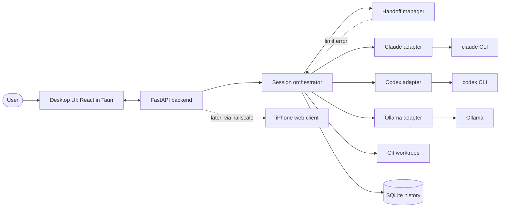

# Plan: Multi-Agent Hub

Working name: `multi-agent-hub`. Status: confirmed by the user in the planning interview. Platform: Windows desktop, personal use only.

## 1. Purpose and requirements

**Problem.** Using Claude Code, ChatGPT/Codex and local models means switching between separate apps, with no shared view of what each agent is doing, and work stops when a subscription runs out of usage.

**Intended user.** The author only (individual use). No accounts, multi-tenancy or hosting.

**Long-term goal.** A centralized place to call upon different AI agents, run several at once on different projects, review their progress and reports, and eventually do the same from an iPhone ("code on the go").

**Platform.** Windows desktop application, hosted on the user's PC. A mobile (iPhone) client is a later phase, not part of the first build.

**Core features**
- Agents: Claude Code, Codex (ChatGPT subscription) and a local model via Ollama.
- Subscription use: Claude and Codex are driven through their official CLIs running under the user's own logins. The application never reads or stores login tokens. API keys are used only where free.
- Parallel sessions on different projects, each showing the active agent and model.
- Session status flow: ready to accept prompt → working → handing off → waiting for input → task completed.
- Progress view per session. The way subagent progress is displayed is undecided and will be settled during the build.
- Clicking a session shows its history and a per-task summary.
- Automatic handoff when an agent hits a limit error (default chain Claude → Codex → local model). The chain is configurable per session, with a default config when the user sets nothing.
- Manual handoff: the user can move a session to another agent at any time with a hand-off button (added 2026-10-25).
- Delegation (later phase, added 2026-10-25): the user hands a sub-task to another agent, which works on it and then returns to the original agent with a short report of what it did and changed, like an orchestrator.
- Parallel split (later phase, added 2026-10-25): several agents work on parts of one task at the same time and their work is combined. It starts with a simple user-triggered split and is developed further later. Several sessions at once on different projects is a separate requirement, covered by phase 4.
- A "waiting for user input" state, so skills that ask the user questions can run.
- UI style: a blend of the Claude Code and Codex interfaces.

**Basis and inspiration.** Not based on an existing product. UI inspiration: Claude Code and Codex.

## 2. Scope and exclusions

**In scope**
- Everything under core features above.
- Git worktrees to isolate parallel agents working on the same repository.
- A UI-independent backend API so a mobile client can be added later.

**Exclusions**
- Gmail and other non-coding agent tasks (deferred by the user; the adapter design should not prevent them later).
- The iPhone app and remote access (postponed to a later phase).
- Multi-user features.
- RAG, evaluations and ML features (the user's future project; the Python backend is chosen so they can be added later).
- Docker isolation in the first build. It is planned as phase 9 (decided 2026-10-25), after phase 4 and before phase 6; see tradeoffs.
- Running or installing agents on the phone.

No out-of-scope item was kept against a challenge. All deferrals are the user's decisions.

## 3. Tech stack and rationale

| Layer | Choice | Label |
|---|---|---|
| Backend | Python + FastAPI: agent sessions, scheduling, handoff, task management | User choice |
| Desktop shell | Tauri, with the Python backend bundled as a sidecar process | User choice (decided 2026-10-22, replacing the Electron default) |
| Remote access (phase 6) | Tailscale, with `tailscale serve` for HTTPS | User choice (decided 2026-10-22) |
| UI | React + TypeScript | User-supplied table, accepted |
| Agent adapters | One interface per agent: start task, send reply, stream events, report limit error, stop | User choice |
| Claude control | Approach A: run the official `claude` CLI headless as a child process and read its streamed events | User choice |
| Local models | Ollama, behind an adapter | User-supplied table, accepted |
| Storage | SQLite: tasks, settings, logs, history | User-supplied table, accepted |
| Isolation | Git worktrees per session or agent (phase 4); Docker containers per session (phase 9) | User-supplied table, accepted; containers added 2026-10-25 |

**Rationale.** Python is the user's strongest language and keeps a clean path to RAG, evaluations and ML. React keeps the UI reusable as a future iPhone web client, and the FastAPI backend already provides the API for it. The adapter interface lets the way an agent is driven be swapped without touching handoff, the UI or history.

**Alternatives considered**
- Node/TypeScript backend: simpler packaging and one language with the UI; rejected because the user is stronger in Python.
- Claude via pseudo-terminal with Claude Code hooks (approach B): lowest policy risk and handles interactive input naturally, but harder to parse and to hand off automatically; kept as a possible adapter swap.
- Claude via Agent SDK or API key (approach C): supported by policy but billed per token; kept as a manual fallback.
- PySide6 desktop UI: one language, but the UI would not carry over to mobile.
- Electron instead of Tauri: more familiar tooling and no Rust, but much larger bundles and idle memory, and it still needs a Python sidecar.
- Self-hosted WireGuard or Cloudflare Tunnel instead of Tailscale: WireGuard needs managed keys and a reachable port; Cloudflare Tunnel is public by design and would need its own login in front of the app.
- Separate Node orchestrator plus Python AI service: more machinery than needed for the first version.

## 4. Tradeoffs

- **Subscription use via official CLIs.** Positive: uses existing subscriptions, with no token handling by the app. Negative: Anthropic's policy on subscription use outside Claude Code and Claude.ai has been contested and changed several times in 2026; secondary sources report server-side blocking of third-party clients and a later reported allowance for CLI-style individual use. **General knowledge, unverified against Anthropic's own current pages** (secondary sources: Gigazine, The New Stack, WinBuzzer). The user accepted this risk for individual use. Fallback: API key per session.
- **Codex via ChatGPT sign-in.** Positive: Codex is included in ChatGPT plans, and `codex exec --json` gives machine-readable events with token usage and failures; `codex exec resume` continues a session. **Verified** against OpenAI help and developer docs (help.openai.com Codex usage limits; developers.openai.com/codex/noninteractive), and the JSON event schema was checked live against codex-cli 0.164.0 on 2026-10-25 (it reports no usage-window status, unlike Claude). Negative: a third-party report says Windows sign-in may still produce API charges; **unverified**.
- **Python backend plus Tauri shell.** Positive: strongest language for the author, and a path to AI features. Negative: three languages (TypeScript UI, Python backend, a small amount of Rust in the shell), a bundled Python runtime (for example a PyInstaller build registered as a Tauri sidecar binary), and the shell must start, monitor and restart the backend. **General knowledge, unverified.**
- **Tauri versus Electron (decided: Tauri).** One 2026 test reports about 3 MB versus 85 MB bundles and about 42 MB versus 168 MB idle memory in favor of Tauri; sources vary and no measurement of a Python sidecar was found, which will dominate the bundle size either way. **Source-reported, partly unverified** (DevToolPicks). Cost accepted: the shell's main process is Rust instead of Node, and the Rust toolchain plus the WebView2 runtime are needed to build. The Tauri webview has its own origin (on Windows reportedly `http://tauri.localhost`), which the backend's `Origin` check must allow; **unverified, check against the Tauri version used**.
- **React UI and FastAPI API.** Positive: the same UI can become the iPhone web app later. Negative: the network layer and login add work then. **General knowledge, unverified.**
- **Git worktrees first, Docker later (decided 2026-10-25: Docker as phase 9).** Worktrees are lightweight, and agents on the same repository do not overwrite each other, but they are not a security sandbox: until phase 9 an agent can still read the user's files (Codex's own sandbox limits writes, not reads; Claude has only permission rules). Docker gives real isolation but costs Docker Desktop on Windows, a separate CLI login inside the container (the Windows logins can't be shared in), a toolchain image per project, and slow file access for projects on the Windows drive mounted into WSL2-based Linux containers. The usual fix for that is keeping projects inside the WSL file system. It is planned before phase 6 because remote control from the phone raises the stakes more than parallel sessions do. **General knowledge, unverified** (in particular the mount speed on this PC and whether Codex's ChatGPT sign-in works inside a container).
- **Limit detection.** "Nearing the limit" may only be detectable after a limit error appears; early warning is best effort. **Unverified.**
- **Vendor handoff.** Sessions cannot share native state across vendors, so context is rebuilt from a written summary plus the git diff. Some detail is lost, and local models are much weaker at coding. **General knowledge, unverified.**
- **iPhone delivery (later).** Installable web app: free, no re-signing, push notifications reportedly need a home-screen install. Free Apple ID sideload: expires every 7 days, 3-app limit, reportedly no push. Paid developer account (about $99/year) removes the limits. **Secondary sources, mostly unverified** (superappp.com, mjtsai.com).
- **Remote access (later, decided: Tailscale).** Tailscale is the easiest private option with a free personal tier (limits differ across sources); self-hosted WireGuard needs managed keys and a reachable port; Cloudflare Tunnel is public by design and would need its own login. Source: homelabstarter.substack.com; **unverified**, check current pricing. Cost accepted: a dependency on a third-party coordination service and the Tailscale app on both the PC and the iPhone. The API is reachable only from devices on the user's tailnet, but the app's own login is still required (phase 6), so a lost or shared tailnet device does not grant control of agents.
- **Interactive input.** Whether headless `claude -p` and `codex exec` support replies mid-run is **unverified**; the fallback is the pseudo-terminal approach for such sessions.
- **Claude Code hooks.** Official hooks docs list `Stop` and `SubagentStop` events (docs.anthropic.com hooks page); field details are from secondary sources. The `claude -p` streaming-JSON flags were **not verified**.

## 5. How the application works

The user opens the desktop app and creates a session for a project, optionally choosing the agent chain. The React interface talks to a local FastAPI backend. For each session the orchestrator creates a git worktree and starts the first agent through its adapter, which launches the official CLI or Ollama and streams events back. The UI shows the agent and model in use, the session status and progress. If an adapter reports a limit error, the handoff manager writes a summary of the task, what is done and what remains, plus the git diff, and the orchestrator starts the next agent in the chain with that summary. When an agent asks a question, the session moves to waiting for input until the user replies. When the work finishes, the session shows task completed. All events and summaries are stored in SQLite, so clicking a session shows its history and per-task summary. The same API is intended to serve a mobile client later.

## 6. Build phases

**Phase 1: Core and Claude** (done 2026-10-24)
- Status: complete. The acceptance test passed in the browser (2026-10-20), and minimal local authentication is in place: per-install token file, bearer check on every route and the stream, `Host`/`Origin` checks, loopback-only binding, token added by the Vite dev proxy. Passing the token from the Tauri main process to the sidecar is part of phase 4d.
- Goal: one Claude session working end to end.
- In scope: FastAPI core, adapter interface, Claude adapter (approach A), SQLite history, basic UI shell, verification of the streaming-event and interactive-input behavior of `claude -p`, the desktop-shell decision (decided 2026-10-22: Tauri), and minimal local authentication (see below).
- Desktop shell: building the Tauri shell and packaging the backend as its sidecar is deferred to phase 4d; until then the UI runs in a browser against the local API, and the Vite dev proxy reads the token file and adds the `Authorization` header to `/api` requests in place of the shell.
- Minimal local authentication: a random per-install token generated on first run and stored locally with user-only access; one FastAPI dependency requiring `Authorization: Bearer <token>` on every REST route and on the event stream (constant-time comparison, 401 otherwise); the Tauri main process starts the sidecar, passes it the token through an environment variable or stdin (not a command-line argument) and injects it into UI requests; the backend binds to `127.0.0.1` only and validates `Host` and `Origin` headers; the token is never logged or written to SQLite. Reason: the API can launch agents that edit files and run commands, and retrofitting auth later would change every endpoint and the event stream.
- Exclusions: Codex, handoff, multi-session dashboard.
- Dependencies: Claude Code CLI installed and logged in.
- Acceptance: the user starts a session, sees status and events, replies to a question, and sees the completed session in history.
- Tradeoffs: including the verification here avoids building on unconfirmed behavior; deferring it risks rework in every later phase.

**Phase 2: Codex adapter** (done 2026-10-25)
- Status: complete. The acceptance test passed in the UI (2026-10-25). Adapter built on `feature/codex-adapter` and tested against a fake CLI; event format, resume, questions and the sandbox were checked live against codex-cli 0.164.0. Billing check done 2026-10-25: after 9 Codex turns, the OpenAI API usage page showed no charges. Codex sessions also show the plan's usage windows (read from Codex's session file) and a token count per turn.
- Goal: the same session experience with Codex.
- In scope: Codex adapter using `codex exec --json` and resume, event mapping to the shared interface, a check of the Windows sign-in billing report.
- Exclusions: handoff.
- Dependencies: phase 1, Codex CLI logged in with the ChatGPT account.
- Acceptance: a Codex session runs and appears in the UI like a Claude session, with no API charges.
- Tradeoffs: doing this before handoff proves the adapter interface works for two different agents.

**Phase 3: Automatic and manual handoff** (done 2026-10-25)
- Status: complete. Built on `feature/hand-off` (2026-10-25). The acceptance test passed in the UI with the real agents (2026-10-25): manual hand-off, and automatic handoff on a limit simulated with the dev-only `HUB_SIMULATE_LIMIT` switch, since a real limit can't be triggered on demand. Design choices confirmed by the user: an agent handed back to starts a fresh session from the brief; the hand-off button starts the new agent at once; the chain config lives in a SQLite settings table; the default limit policy is automatic.
- Goal: work continues on the next agent when a limit error occurs, and the user can move a session to another agent at any time.
- In scope:
  - **Agent stints.** A session becomes a sequence of stints. Each stint records its agent, model, native session id, status, why it started (`new`, `limit`, `manual`, later `delegation`) and an optional parent stint it returns to. Phase 3 never sets the parent; it exists so delegation (phase 7) and the parallel split (phase 8) need no schema redesign. Running state is tracked per stint, not per session; phase 3 still allows only one running stint per session, so lifting that limit later is a rule change, not a rewrite. One transcript per session, with a divider at each handoff; events already record their agent.
  - **Handoff brief.** Built by the hub from saved events, not written by an agent, so it costs no agent turns and works when the outgoing agent is out of usage: the original task and the user's later messages, the previous agent's final messages, files and commands it touched, what remains if known, and `git status` plus the diff.
  - **Chain config.** A global default (Claude → Codex → local model) on a settings screen, a per-session override in the New session dialog, and a policy for limits: hand off automatically, or ask first.
  - **Automatic handoff** on `LIMIT_REACHED`: the next available agent in the chain starts a new stint with the brief. If no agent is left, the session fails as today.
  - **Manual hand-off button** in the session view: pick an agent and the same handoff runs, with the reason `manual`. It is also how handoff is tested without exhausting a real usage limit.
  - **UI:** the handoff divider with its reason, the current agent in the header, and the brief viewable from the divider.
- Exclusions: local model in the chain until phase 5 (shown but disabled); delegation and returning to the original agent (phase 7); running more than one stint at a time.
- Dependencies: phases 1 and 2.
- Acceptance: a simulated limit and a manual hand-off each move a session from Claude to Codex (and back), and the task continues from the brief without the user repeating it.
- Tradeoffs: early-warning detection is best effort (Claude reports usage windows during a turn, Codex only after it); the context lost in a brief may require the user to correct course; a hub-built brief is cheaper and always available, but less tailored than one written by an agent.

**Phase 4: Multi-session dashboard and isolation** (split into sub-phases 4a to 4d on 2026-10-26; each is built, tested and committed on its own)
- Goal: several sessions on different projects, reviewable in one place.
- Exclusions: remote access.
- Dependencies: phases 1 to 3.
- Acceptance (whole phase): two or more sessions run in parallel without file conflicts, and each session's history and summary are viewable.
- Tradeoffs: worktrees are not a sandbox (containers come in phase 9); the subagent display decision may need a design iteration.

**Phase 4a: Runner interface and git worktrees** (built 2026-10-26, Session 20; awaiting the user's test with a real project)
- Runner interface: every agent launch goes through one small interface that starts a CLI in a folder, sends the prompt, streams the output and kills it. Only the host runner (today's behavior) ships here; phase 9 adds a Docker runner behind the same interface, so the orchestrator, handoff, worktrees and UI don't change.
- Git worktrees per session: on by default for git repositories, with an opt-out per session; all in one hub folder (`%LOCALAPPDATA%\MultiAgentHub\worktrees`); each session works on its own `hub/...` branch. Removing a worktree deletes the folder and keeps the branch for the user to merge; uncommitted changes must first be committed to the branch or discarded. The handoff brief diffs against the branch's base commit.
- The worktree handling can create, track and remove a worktree for any stint, not only for a whole session, because phase 8 reuses it per stint (the `stint_id` column exists; phase 8 sets it).
- Acceptance: two sessions on the same repository work in separate folders and branches without touching each other or the user's checkout; removing a worktree keeps committed work on its branch.

**Phase 4b: Dashboard, progress view, history and summaries**
- Dashboard: every session at a glance (title, project, current agent, status, branch, last activity), so several sessions can be watched in one place.
- Progress view (decided 2026-10-26): a running turn's plan (to-do list with a progress bar) and its subagents are shown in a checklist panel above the transcript by default (layout A). A layout switch offers a split view instead (layout C): the transcript on the left and a side panel with the plan, subagents and files touched, which drops below the transcript on a narrow screen. The choice is saved as a hub setting.
- Plan source (decided 2026-10-26): neither CLI offers its plan tool headless (Claude Code's `TodoWrite`, Codex `exec`'s `update_plan`), so the hub's headless prompt asks both agents to write the plan as a markdown checklist under a `[[PLAN]]` line and re-post it after each step, and the hub turns it into the plan. Confirmed live with both agents on 2026-10-26. Later: look for a Codex mode that offers `update_plan` (such as the app-server).
- Per-session history: the session's stints, handoffs and turns, easy to review after the fact.
- Summaries (decided 2026-10-26): a hub-built summary from events and git, kept current throughout the session at no usage cost, plus a "Re-summarize" button that asks an agent for a written summary on demand, so the user can return after a break and see what the session was about and which step it is on. The session's current agent writes it (decided 2026-10-26), as a separate one-off call so the recap doesn't clutter the session's own conversation, falling back to the next agent in the handoff chain if that agent is out of usage. Still to decide in 4b: how its usage cost is shown.
- Acceptance: with two or more sessions running, the dashboard shows each one's state, and each session's summary and history can be opened.

**Phase 4c: Claude Code and Codex style polish**
- Bring the UI closer to the look and feel of Claude Code and Codex (transcript, tool rows, composer, colors), including smaller carried-over items such as tables in the transcript.
- Acceptance: the user signs off on the look.

**Phase 4d: Tauri desktop shell**
- The Tauri shell, with the backend bundled as a sidecar that the shell starts, monitors and restarts, and to which it passes the auth token (replacing the Vite dev proxy's role). App data moves to `%LOCALAPPDATA%\MultiAgentHub`, next to the worktrees.
- Dependencies: Rust (rustup with the MSVC toolchain) installed on the PC; not installed as of 2026-10-26.
- Acceptance: the app starts from its desktop shortcut, the backend comes up with it, and it restarts if the backend crashes.

**Phase 5: Local model**
- Goal: Ollama as the last-resort tier.
- In scope: Ollama adapter, local model selection, addition to the default handoff chain.
- Exclusions: RAG, evaluations.
- Dependencies: phases 1 to 3, Ollama installed with a chosen model.
- Acceptance: a handoff from Codex to a local model completes a simple task, with the quality limits clearly shown.
- Tradeoffs: local models are weaker at coding, and hardware determines usefulness; the model choice is open.

**Phase 7: Delegation** (added 2026-10-25; can be built before phase 6, which is marked later. Numbered 7 so existing references to phase 6 stay valid.)
- Goal: an orchestrator-style session. The current agent hands a sub-task to another agent, which completes it and returns control to the original agent with a report.
- In scope: a delegate action (button or slash command such as `/delegate claude write tests for the parser`) that starts a child stint with the handoff brief plus the sub-task; the child works through as many turns as needed, and its questions reach the user as usual; on completion the hub resumes the parent stint with a return report (the sub-task, the child's final message, files changed from git, commands run); the parent agent then gives the user a brief overview and continues. Later in the phase: agent-initiated delegation, where an agent ends its turn with a marker such as `[[DELEGATE claude: ...]]` (the same mechanism as `[[NEEDS_INPUT]]`), rather than an MCP tool that would block for minutes.
- Exclusions: running several delegates at the same time (phase 8).
- Dependencies: phase 3; phase 5 only if the local model is a delegate.
- Acceptance: in a Codex session the user delegates a task to Claude, Claude completes it, and the session returns to Codex, which summarizes what Claude did and changed and continues.
- Open: what happens when the delegate hits its limit (return a partial report, or move along the chain); exactly what the return report lists.
- Tradeoffs: each agent sees a brief, not the other's full reasoning; delegating costs extra turns on both agents.

**Phase 8: Parallel split (minimal)** (added 2026-10-25; a first version, developed further later)
- Goal: several agents work on parts of one task at the same time, then their work is combined and the original agent continues.
- In scope:
  - **Trigger:** a Split action (button or slash command) where the user lists the sub-tasks and assigns an agent to each, for example `/split claude: build the settings page | codex: add the settings API`.
  - **Running:** each sub-task becomes a child stint of the current stint and runs at the same time as the others, in its own git worktree and branch created from the session's current state. Each child gets the handoff brief plus its sub-task. Questions from a child reach the user as usual, labelled with that child.
  - **Progress:** the session view lists the children with their agent, sub-task and status, and each child's transcript can be opened.
  - **Combining:** when all children have finished, the hub merges their branches back into the session one at a time. A clean merge continues automatically; a conflict stops and is shown to the user, and nothing is resolved automatically.
  - **Return:** the parent stint resumes with a combined report (per child: sub-task, final message, files changed, merge result), and the original agent gives the user an overview and continues.
- Exclusions (later development): the agent proposing or planning the split itself; automatic conflict resolution; sub-tasks that depend on each other; children splitting again; a live side-by-side view; limits on how many agents run at once.
- Dependencies: phase 4a (worktrees) and phase 7 (child stints and the return report). The project folder must be a git repository.
- Acceptance: in one session, the user splits a task between Claude and Codex, both work at the same time on different files, their changes are merged into the project, and the original agent summarizes what each did.
- Tradeoffs: agents running at once use several subscriptions' limits at the same time; sub-tasks that touch the same files will conflict, so splits work best along clear file boundaries; two children asking questions at once compete for the user's attention.

**Phase 9: Container isolation (Docker)** (added 2026-10-25; numbered 9 so existing phase numbers stay valid; planned after phase 4 and before phase 6)
- Goal: agents run inside Docker containers, so a misbehaving or prompt-injected agent can reach only its session's files, not the rest of the user's PC.
- In scope:
  - **Docker runner** behind the phase 4a runner interface: one container per session (or per stint, for phase 8 children), with the session's worktree mounted as the only project folder, started by the hub and stopped when the session ends; the agent's turn runs through `docker exec`, and stopping a turn kills the process inside the container.
  - **Agent logins in containers:** each CLI is signed in once inside the container, through its official login flow, with credentials kept in a named Docker volume reused by every container. The hub still never reads or stores tokens.
  - **Agent state paths:** the Codex usage reader and the session ids work against the container's volumes (for example Codex's session files), not the Windows home folder.
  - **Project images:** a default image with common toolchains (Python with uv, Node), and a per-project override (a Dockerfile or dev container config in the project).
  - **Per-session choice:** container or host runner, with a global default; the host runner stays for projects that don't fit a container.
  - **File-location decision:** whether projects move into the WSL file system for speed or stay on the Windows drive, measured on this PC first.
- Exclusions: network egress filtering beyond Docker's defaults (later); running the hub backend itself in a container.
- Dependencies: phase 4a (runner interface and worktrees). Docker Desktop installed with the WSL2 backend. Phase 8 benefits but does not depend on it.
- Acceptance: a Claude session and a Codex session each run in their own container, complete a task in the project, can't read a file planted outside the mounted folder, and hand off to each other as before.
- Open: whether Codex's ChatGPT sign-in works inside a container (device-code or browser flow); Claude Code's official dev container setup as a starting point; image size and start-up time; how the Codex and Claude permission settings change inside a container (their own sandboxes may be redundant there).
- Tradeoffs: real isolation, at the cost of Docker Desktop's memory and start-up time, a second login per agent, per-project images, and slower file access unless projects live in WSL.

**Phase 6 (later): iPhone access**
- Goal: monitor and control sessions from the phone.
- In scope: network exposure of the API, full login (password or passkey, session cookie with `Secure`, `HttpOnly` and `SameSite` flags), device pairing (for example a QR code from the desktop app), rate limiting and token revocation, mobile web client as an installable web app, private remote access (Tailscale with `tailscale serve` for HTTPS, decided 2026-10-22; FastAPI serves the built React app same-origin; a Vercel-hosted frontend is not needed for a single user), and push notifications for waiting-for-input, handoff and completion.
- Availability caveat: the PC must stay on, awake and online, with the backend and the remote-access client starting at boot or login.
- Exclusions: running agents on the phone.
- Dependencies: phases 1 to 4; phase 9 (containers) recommended first, because remote control raises the impact of a misbehaving agent.
- Acceptance: from the phone, the user can see session status and send replies.
- Tradeoffs: see iPhone delivery and remote access above.

## 7. Decisions, assumptions, and open questions

**Confirmed decisions**
- Desktop application, personal use, Windows.
- Python + FastAPI backend.
- Approach A for Claude with a swappable adapter interface.
- Automatic handoff on limit error, configurable per session with a default config.
- Phase 3 also includes a manual hand-off button, and its data model (agent stints with a reason and an optional parent) is designed for delegation and parallel work later (decided 2026-10-25).
- Delegation with return to the original agent is its own phase (phase 7), built after handoff so it reuses stints, the brief and the chain config (decided 2026-10-25).
- Parallel split of one task across several agents is wanted, starting with a minimal user-triggered version in phase 8 and developed further later; several sessions at once stays in phase 4 (decided 2026-10-25).
- Mobile postponed; Gmail and non-coding agents deferred.
- Phase order as in section 6. Planned build order (2026-10-25): 3 (done), 4, then 5 and 7, then 9, then 8 and 6.
- Docker container isolation is its own phase (phase 9), after phase 4 and before phase 6; phase 4 (4a) adds the runner interface it plugs into (decided 2026-10-25).
- Phase 4 is split into sub-phases 4a (runner interface and worktrees), 4b (dashboard, progress view, history and summaries), 4c (style polish) and 4d (Tauri shell), built in that order (decided 2026-10-26).
- Phase 4 worktrees (decided 2026-10-26): on by default for sessions in a git repository, with an opt-out per session; all worktrees live in one hub folder, `%LOCALAPPDATA%\MultiAgentHub\worktrees`, for easy cleanup (not `backend/data`, because Claude Code would load the hub's own `CLAUDE.md` from the parent folders); each session works on its own `hub/...` branch, and when done the user removes the worktree (folder deleted, branch kept) and merges the branch themselves.
- Phase 4 summaries (decided 2026-10-26): both kinds. A hub-built summary from events and git, kept current throughout the session at no usage cost, plus a "Re-summarize" button that asks an agent for a written summary on demand, so the user can return after a break and see what the session was about and which step it is on. The session's current agent writes it, in a separate one-off call, with the handoff chain as the fallback (decided 2026-10-26).
- Phase 4b progress view (decided 2026-10-26): checklist panel above the transcript by default, with a split view (side panel with plan, subagents and files touched) as a switchable option.
- Phase 4b plan source (decided 2026-10-26): a `[[PLAN]]` checklist in the agents' messages for now, because neither CLI offers its plan tool headless; a Codex mode with `update_plan` is to be looked into later.
- UI blends Claude Code and Codex.
- Stack items from the user-supplied table are accepted except the Node orchestrator and the separate Python AI service (merged into the FastAPI backend) and Docker (moved out of the first build into phase 9).
- Tauri is the desktop shell (decided 2026-10-22, replacing the Electron default). Effect: smaller and lighter shell, but its main process needs some Rust; the shell itself is built in phase 4d.
- Tailscale is the remote-access method for phase 6 (decided 2026-10-22).

**Assumptions**
- Windows only.
- The CLIs and Ollama are installed and logged in by the user separately.
- SQLite is local to the PC.
- Default handoff chain is Claude → Codex → local model.

**Unresolved**
- Claude's default permission mode. With `acceptEdits` (the current default) and no approval surface, every shell command is denied headless, so Claude can't run tests or git. `auto` (Claude Code's classifier approves safe actions) works headless and was used on 2026-10-26 via `HUB_CLAUDE_PERMISSION_MODE=auto`; whether to make it the default is open. Neither is a sandbox (phase 9).
- Local model runtime model and hardware (Ollama chosen; specific model open).
- Whether headless `claude -p` and `codex exec` support mid-run user input (check in phase 1).
- Current Anthropic policy on subscription CLI use (recheck against Anthropic's own pages).
- Windows Codex sign-in billing report: checked 2026-10-25 with ChatGPT login and no API key set; no API charges appeared.
- Whether limit nearing can be detected before the error.
- How the parallel split develops after its minimal version (phase 8): agent-proposed splits, conflict handling, dependent sub-tasks, and the live view.
- Placement of phase 7 relative to phase 5 (both depend only on phase 3). Phase 8 comes after phases 4 and 7.
- Phase 9 details: Codex's ChatGPT sign-in inside a container, the default image's contents, and whether projects move into WSL for file speed.
